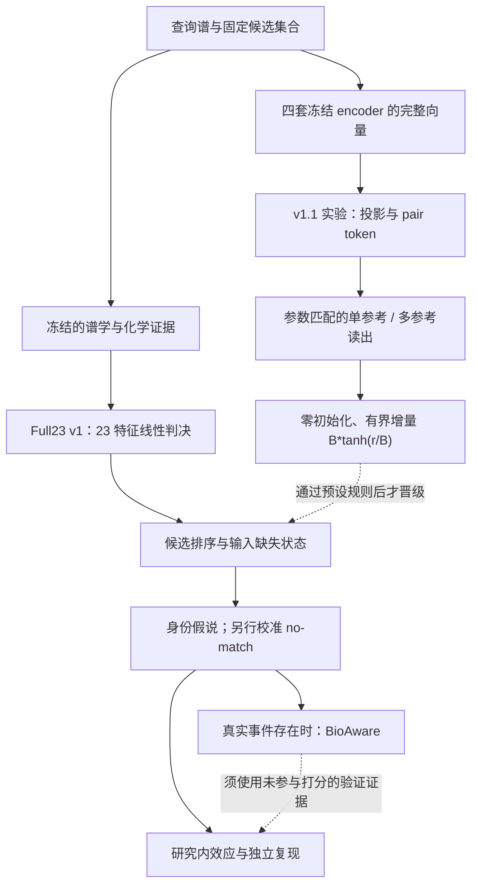

# Full23 v1 / v1.1：竞争研究、应用取舍与论文计划

核查日期：2026-10-27；同日按 `run_2420264` 更新。代码基准：`5d17fc12a47246e9e37df3a8b330caee8cc11000`（含 `fd1575d` 初版及 `d05f555` 有界残差修订），分支 `codex/contrast-atlas-panredu-20261016`。本报告包含竞争研究判断以及 v1.1 bounded 的后续开发裁决；不把该裁决写成独立外测。

## 1. 当前判断

已有跨来源增益、严格重拟合消融和可复用发布包，足以开始组织一篇严肃的方法稿；还不能据此宣布外部 SOTA。现在真正影响论文说服力的是：直接竞争方法是否比齐、化学证据为何有效、部署时错误是否受控，以及算法增益能否转化成一个可独立检查的应用结果。继续堆数据、改融合器名字或制作更大的疾病网络，均不能代替这些证据。

本轮检索分为谱库排序、结构检索、公共数据检索、反向代谢组、跨研究特征连接、功能应用六类。下列来源以原始论文、原始摘要及作者工具为主。部分 Nature 全文入口跳转认证，部分 PMC 返回验证码；相应条目依据原文索引和摘要核查，未宣称逐段读完全部补充材料。预印本明确标记；不采用搜索摘要中的“最佳”形容词作为项目结论。

## 2. 先校正版本与最新应用状态

正式发布仍是 **Unified Additive Full23 v1**。其 23 个候选级特征来自 Noise、Stage-1、Phase-A、FullMSG、WSE、P2b-on-Noise、Noise-MSG 和 V2，排序头为 23 weights + bias。Official fine-tuned DreaMS 是基线，也有间接 geometry 依赖。Noise 不是被排除的附属模块；但现有严格重拟合没有 without-Noise，不能把完整性能的某个比例归给 Noise。

**v1.1 bounded 已在 `run_2420264` 完成并确定不晋级。** 它保留冻结 v1 分数，增加四套完整 embedding 的有界残差：每套 1024→16，使用 query/reference 投影、对称 pair token、候选内 masked mean/max pooling和约 7.2 万可训练参数的小型输出头。Top-1 reference 与 Top-3 references 是独立训练、同参数量、同预算的两臂；另有 reference 置换内容对照。最终 `selected=full23_v1`，不存在 v1.1 发布包。

最新文档报告 `run_2419582` 无界 residual + L2 的 GNPS 结果为负。`d05f555` 将最终分数改为 `s_v1 + B*tanh(r/B)`；`5d17fc1` 加 schema/transform preflight，拒绝旧无界代码。B 只由 Enveda OOF parent margin/deficit 计算，文档值 0.6255066395，任意候选对相对分数最多改变 2B=1.2510132790。训练账本中的 81.93% correct decisions 受该边界结构保护、50.01% positive error deficits 在容量内可触达，是训练容量描述，不是新准确率，也不是 GNPS 的保护比例。

**协议时间线还需谨慎：** `fd1575d` 保存的公式是 parent score + residual，checkpoint 字段也明确写 unbounded；具体 B 规则在后续修订中加入。因此仅凭当前 Git 记录，不能确认具体有界方案在第一次 GNPS 结果之前已经预设。若有更早独立合同，应附上原始记录；否则按看到开发失败后的合理方法修订报告。B 数值只从 Enveda 计算，不等于方法设计完全未受 GNPS 反馈影响。这不禁止修订，但必须保留失败运行，也不允许把重跑说成未开封确认。

v1.1 用 Enveda 原五折 OOF parent score 训练残差，GNPS 用 final parent；这避免了一类堆叠标签泄漏，但不让 Enveda 或 GNPS 重新成为独立测试。GNPS 晋级仍属于已消费开发选择。两项结论均已回答：Top1/Top3 均未超过 v1，Top3 也未超过参数匹配 Top1 或 reference permutation。完整结果见 `FULL23_V11_BOUNDED_RESULT_20261027.md`。

当前发布结果（R@1，%）：

| 面板 | queries / candidates | Official | Noise | WSE | Full23 v1 |
|---|---:|---:|---:|---:|---:|
| Enveda identity | 25,000 / 668,458 | 53.100 | 55.536 | 73.028 | 77.592 |
| Enveda formula | 9,435 / 58,757 | 67.207 | 69.528 | 85.056 | 86.084 |
| GNPS identity | 10,995 / 87,518 | 85.357 | 86.558 | 87.367 | 88.249 |
| GNPS formula | 5,261 / 24,401 | 86.809 | 88.063 | 88.272 | 89.527 |

Enveda、GNPS 去重 query 分别为 30,343、11,019；面板不能直接相加。谱数量不等于独立分子、公式簇或研究数。规模已足以检测已报告效应，主要缺口是代表性、训练重叠、竞争覆盖和独立验证，而非必须机械增加到百万 queries。现有 sampling 文档需随稿交付实际 eligible universe、抽样规则/seed、排除与候选数分布，不能只称“随机大样本”。

Full 相对 Official+WSE learned control 在四面板的严格重拟合增益为 +2.760/+0.827/+0.809/+1.083 pp，报告 CI 均为正。V2 是四面板均有支持的独立组增量；三个额外 ChemAware encoder 的跨来源独立 Top-1 收益尚未确认。B 是 GNPS 内训练的不同条件对照，不是所有来源的通用金标准。micro-AUPRC 增益不等于概率校准，也不能替代 query-level 排序和拒识。

最新 atlas 文档是 `CONTRAST_ATLAS_FIXED_EDGE_ENCODER_APPLICATION_RESULT_20261027.md`，不是旧 2/30 汇报：15 sources、51 contrasts、54,861 study entities；41,082 行包含不同 evidence worlds，all-world 只有 20,485 unique edges。Official/Stage-1 覆盖 38,475/41,082 行。

药物正控 all/nonmass 是 24 个方向、12 个无向药物对单元。coverage-matched fragment、Official、Stage-1 的 Top-1 为 3/24、2/24、4/24；Top-5 为 10/24、13/24、13/24；中位 rank 为 7.5、4.5、4.5。成人→儿科 IBD combined 为 Top-1，反向 rank 4。这些是值得保留的开发信号；Stage-1 尚无相对 Official 的整体胜利，也没有证明 unresolved 的稳定额外收益。目前是在旧 fragment-cosine 图上重加权，尚未检验 Full23 新候选连接能力。

## 3. 竞争矩阵：什么必须比，什么只在相应任务比较

| 方法/工作 | 主要任务及已有贡献 | 本项目处理 |
|---|---|---|
| DreaMS，Nat Biotechnol，2025 online / 2026 issue [1] | 大规模自监督表示，多个微调任务及可复用模型 | 官方微调权重为必比；固定 checkpoint、预处理和训练重叠。不能以我们单一身份任务胜出推断全面超过 foundation model。 |
| WSE / spectral entropy [2]；Flash entropy search [3] | 强谱库匹配与大规模搜索 | WSE 保留主基线；核实本项目 WSE 与公开实现的公式/预处理。Flash 主要补速度，不把相同打分的快实现当独立准确率算法。 |
| MSBERT，Analytical Chemistry 2024 [4] | mask/contrastive 谱表示，库匹配与类似物检索 | 当前唯一高优先级的新同轴谱表示基线；先核实官方权重、GNPS 训练重叠、输入过滤与可运行性。 |
| MS2DeepScore 2.x / 2.0，Nat Commun 2026 [5] | 化学相似预测，最新版增加跨极性能力 | 公开 dual-mode 2024 模型已用 `ms2deepscore==2.4.0` 完成同轴评分。只有论文/2.5.3 权重与已测工件实质不同才新增，不重跑同一模型；身份 R@1 不能概括其全部类似物目标。 |
| Spec2Vec，PLoS Comput Biol 2021 [6] | 学习峰/损失的语义表示 | public GNPS 模型及 2026 retrained 均已完成同轴评分；直接复用 frozen ladder，不再计算。 |
| MS2Query，Nat Commun 2023 [7] | MS2DeepScore 检索后结合 Spec2Vec、质量和库邻域证据做随机森林排序 | 最重要的“已有多证据学习重排”先例；原生全库 analogue/exact-match 任务与固定 10-ppm 身份轴不同。任务差异登记为必需，原生或明确适配比较为可选，不阻塞主线。不得把“低容量融合多个证据”本身当首创。 |
| MVP，Analytical Chemistry 2026 [8] | 多视角谱/分子表示的结构候选检索 | 若主张结构检索，另开同任务面板；不把其原文分数和本项目有参考谱的身份检索直接横比。 |
| mWISE，Analytical Chemistry 2021 [9] | feature table 和生物/反应网络上下文注释 | 有相应 feature/context 才比较；单谱身份排序不能强行伪造其输入。 |
| MASST / fastMASST / FASST [10] | 公共谱出现位置搜索，支持未知谱 | 作为 atlas 检索基础设施/功能比较；不是一个可直接与 Full23 R@1 比的模型。 |
| StructureMASST，Nat Biotechnol 2026 [11] | 名称、结构、子结构驱动公共搜索及修改容忍搜索 | 直接限制“首次跨库/跨病定位分子”的创新主张。可用于候选核验，不能只画 occurrence 热图与其竞争。 |
| Pan-ReDU，Nat Commun 2025 [12] | 跨公共仓库元数据统一与检索 | 借用来源与元数据体系；其功能边界不能代表整个领域没有 quantitative meta-analysis。 |
| Reverse metabolomics，Nature 2023 online / 2024 issue；2025 protocol [13,14] | 化学/谱出发，公共搜索后做关联及验证；protocol 也接受未知谱起点 | 借鉴证据闭环；不能声称未知谱反向关联是首次，也不能因没有新合成就认为无法采用这一思想。 |
| FBMN、Qemistree [15,16] | 定量特征与谱网络、化学家族层级的样本解释 | 家族/网络应用应有传统网络加相同下游统计，不能只对比裸 cosine。 |
| metabCombiner / 2.0 [17] | 跨数据集 feature-table 匹配 | 若 RT 与 feature table 适用，列条件对照；不可宣称未知 feature 跨研究匹配以前不存在。 |
| MassQL，Nat Methods 2025 [18] | 可复用化学碎片/损失模式查询 | 家族发现的解释性补充或规则基线；不是结构确证。 |
| GNPS Drug Library，Nat Commun 2025 [19] | 参考谱、类似物和公共药物暴露证据 | 药物应用的资源与混杂检查。单纯药物出现图不足以创新。 |
| HuMMANet、Carnitine landscape、ChemProp2，2026 预印本 [20–22] | 跨研究 microbiome-metabolome、家族公共景观、时间序列药物转化 | 竞争动态；不能写成已同行评议。ChemProp2 仅在有适配时间/扰动数据时比较。 |
| Local-network similarity evaluation，Analytical Chemistry 2026 [23] | 系统检查谱相似图的局部化学可靠性 | 提醒排序、网络连边与化学身份是不同验证对象；阈值和图密度不能代替身份验证。 |

SIRIUS/CSI:FingerID、CFM-ID、FLARE、MassSpecGym 结构检索等属于另一任务族。若论文扩展到无参考谱的结构注释，必须重新建立该任务的输入、训练隔离与候选协议；目前不为追求“全面”而把不可比数字摆进同一排行榜。

### 已完成的公开模型同轴结果，不得重复运行

`deliverables/GLM_gnps_article_ladder/run15/ladder_full.csv` 已在 identity-disjoint 10,995 queries 和 formula-disjoint 5,261 queries 上保存完整逐方法指标；`verification_report.json` 从逐 query 表复算并以 `1e-9` 容差核对全部 R@k、MRR、rank、margin、near 和错误交换。Spec2Vec public 的 R@1/MRR 为 `86.294/91.020%` 与 `87.436/92.367%`；MS2DeepScore 2.x public 为 `79.118/86.365%` 与 `81.467/88.737%`。两者使用 GNPS 生态预训练数据，因此属于实用社区基线，不是严格 OOD 证据。Full23 的当前 GNPS 数字可与这些 frozen 行做同轴开发比较，但仍不能据此宣称未开封外部 SOTA。

## 4. 前人文章为什么成立

DreaMS 的论证覆盖表示学习资源、迁移到多个任务及工具复用。审稿人不是只看我们现在这个 10 ppm 身份面板；本项目在此胜过它，具有价值，但没有否定其原论文贡献。[1]

MS2Query 是最直接的警示：多模型证据加一个学习排序器已经有先例。[7] 我们可防守的具体贡献必须来自 Noise/化学证据训练和对照机制、跨来源误差交换、以及实际可恢复的化学信息。V2 的 correct-minus-null 是目前证据最整齐的一条；还需排除缺失模式、候选来源或库标记代理变量。v1.1 的 Top3/Top1/置换结果未支持多参考机制，因此不得把完整 embedding readout 写成论文创新。

Reverse metabolomics 将候选化学与独立生物支持衔接；StructureMASST 证明了可复用的新检索能力。[11,13] 两类论文成功方式不同。我们不需要硬凑全面机制论文，但需要把“算法改善了什么分析结论”讲到具体实体。

## 5. Atlas 的主问题与最小有价值应用

建议主问题：**更可靠的跨研究 MS/MS 连接，能否增加在独立研究中复现的实体或化学家族响应？**

atlas 是证据目录，主结果是一条可核查链：谱/特征 → 身份或关系假说 → 来源文件与研究 → 研究内效应及不确定性 → 独立复现/否定 → 化学支持。疾病名称只提供上下文；病例共同出现、谱相似、同一分子和共同病理机制不能互相替代。

采用双轨：

1. **身份轨**：在预先冻结的质量、极性、adduct 等物理兼容集合内比较所有方法。没有谱学阈值准入。相同实体才可讨论该实体的效应复现。
2. **关系轨**：非同前体谱关系只支持类似物/化学家族假说。使用相应 analog 方法与片段证据；不把 Full23 身份头直接当不同质量之间的关系真值，也不把不同分子的 beta 合并成同分子效应。

旧固定边实验保留为可复算的重加权诊断，但它的候选由旧 cosine 预选，会遮蔽新算法找回漏连边的能力。另建明确标记的新、模型无关候选实验，先固定范围和分母，再看响应；不能悄悄改旧实验的轴。

主线先用已有成人/儿科 IBD 作为 consumed discovery：审查基质、病例定义、年龄、用药、协变量和样本结构，再选择一至两个证据完整的实体/家族。已知胆酸与 IBD 的关系是合适正控，不可包装为新发现。当前无新独立数据时先做发现和可复用连接，不改名为外测。最后只针对具体假说增加必要的独立队列或标准品/正交验证；不恢复无限扩库。

备线是现有数据中设计充分的药物转化或扰动家族：必须有具体 parent/product、时间/剂量或合适对照，不能用同药标签 Top-5 代替代谢机制。不同药也可能产生相似响应，同药也会因组织/剂量不同而不相似；未标注关系是 unjudged，不是真负例。

每个方法报告 retained/changed/gained/lost 的实体级账本，并说明每项变化获得多少独立响应支持、多少矛盾、多少无信息。匹配覆盖、边数、观测率及节点度数对照；用研究/受试者/实体的实际依赖结构推断，不把成千上万条边当独立重复。对 all/known/unresolved 的比较同样适用。

“全局性的暴力破拆”未核实为正式方法名；可能指全库穷举检索，也可能指碎裂/子结构枚举，不能混称。当前可执行的含义是：在合理理化边界内全候选打分，再做预定多重检验和独立验证。它解决覆盖问题，不自动解决化学身份与生物混杂。

## 6. 稿件组织与投递决策

建议按 **Analytical Chemistry 方法论文**优先组织，暂定叙事是“统一谱学与化学证据，提高跨来源谱库匹配并支持可追溯的跨研究响应分析”。这是一条基于目前资产的建议，不是期刊录用保证。ACS 官方 scope 包括分析数据处理及测量方法改进，并不要求每篇算法稿都完成新的疾病机制。[24]

五组主图：

1. 问题、适用条件、训练/评估数据角色及最终 Full23 v1 算法图；v1.1 作为未晋级开发结果放补充材料。
2. 同候选轴强基线比较：R@1/MRR、置信区间、corrected/introduced 与来源分层；补实测成本。
3. 机制：严格重拟合消融、V2 对照；补充材料报告 v1.1 Top-3 vs 参数匹配 Top-1 与置换的负结果。
4. 可靠性：误配、真值不在库、coverage-risk、缺输入与计算资源；不可把“输入缺失弃权”说成已解决开放集识别。
5. 一个完整应用：算法改变的实体 → 化学支持 → 研究内响应 → 独立证据。全 atlas、失败案例与 51 contrasts 的来源放补充/资源。

结果不按训练历史排列，也不为每个模块强行设一个成功小节。没有独立化学/响应增量时，atlas 降为应用边界和资源说明，方法稿仍可推进；不要虚构新机制。Nature Methods / Nature Biotechnology / Nature Communications 需要与其主张相称的广泛能力或生物发现，不能由目前百分比推导可投中。

发稿前门槛：直接方法比较完成；一个预先冻结的外部验证或明确限于开发证据的主张；合法输入/拒识/运行成本说明；至少一个可信应用链。可以立即起草 Introduction、Methods 和已完成 Results，待未完成结果后更新摘要。可选择预印本并向期刊披露；不同时向多个期刊投稿。[24]

## 7. 原始来源登记

以下链接用于核查范围与竞争定位，不代表原文分数可横向比较。

1. DreaMS: https://doi.org/10.1038/s41587-025-02663-3 ; https://dreams-docs.readthedocs.io/en/latest/
2. Spectral entropy: https://doi.org/10.1038/s41592-021-01331-z
3. Flash entropy search: https://doi.org/10.1038/s41592-023-02012-9
4. MSBERT: https://doi.org/10.1021/acs.analchem.4c02426
5. MS2DeepScore 2.0: https://doi.org/10.1038/s41467-026-69083-y
6. Spec2Vec: https://doi.org/10.1371/journal.pcbi.1008724
7. MS2Query: https://doi.org/10.1038/s41467-023-37446-4
8. MVP: https://doi.org/10.1021/acs.analchem.5c05675
9. mWISE: https://doi.org/10.1021/acs.analchem.1c00238
10. MASST: https://doi.org/10.1038/s41587-019-0375-9 ; https://ccms-ucsd.github.io/GNPSDocumentation/masst/
11. StructureMASST: https://doi.org/10.1038/s41587-026-03082-8
12. Pan-ReDU: https://doi.org/10.1038/s41467-025-60067-y
13. Reverse metabolomics: https://doi.org/10.1038/s41586-023-06906-8
14. Reverse protocol: https://doi.org/10.1038/s41596-024-01136-2
15. FBMN: https://doi.org/10.1038/s41592-020-0933-6
16. Qemistree: https://doi.org/10.1038/s41589-020-00677-3
17. metabCombiner: https://doi.org/10.1021/acs.analchem.0c03693 ; 2.0: https://doi.org/10.3390/metabo14020125
18. MassQL: https://doi.org/10.1038/s41592-025-02660-z
19. GNPS Drug Library: https://doi.org/10.1038/s41467-025-65993-5
20. HuMMANet PREPRINT: https://doi.org/10.64898/2026.08.24.746727
21. Carnitine landscape PREPRINT: https://doi.org/10.64898/2026.03.27.714844
22. ChemProp2 framework PREPRINT: https://doi.org/10.64898/2026.01.30.702925
23. Local-network evaluation: https://doi.org/10.1021/acs.analchem.6c01202
24. Analytical Chemistry author guidelines (accessed 2026-10-27): https://researcher-resources.acs.org/publish/author_guidelines?coden=ancham

详细执行合同另见 `ALGORITHM_AGENT_NEXT_TASKS_FULL23_V11_20261027.md` 和 `BIOLOGY_AGENT_NEXT_TASKS_RESPONSE_ATLAS_20261027.md`。本次依据远端文档、原始报告和实现核查，不声称已在用户集群重新训练、重算原始谱或完成新外测。

机器可读的去重与执行状态见 `FULL23_COMPETITOR_MANIFEST_20261027.json`。它明确把已完成的 Spec2Vec/MS2DeepScore 行设为 `complete_reuse_no_rerun`，仅将 MSBERT 保留为下一项直接表示基线。
