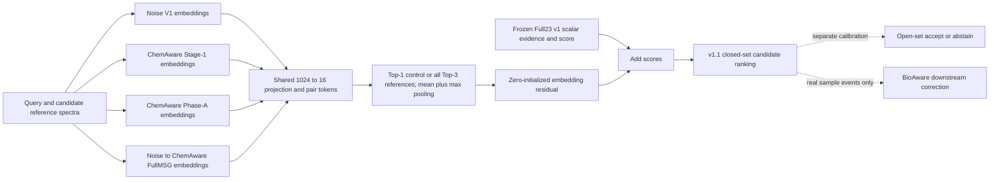

# Full23 v1.1 multi-reference embedding increment

## Version identity

The currently frozen ranking package remains **Unified Additive Full23 v1**:

- package: `deploy/unified_additive_full23_v1`;
- arm: `additive_linear_control` with 23 candidate-varying scalar features;
- checkpoint SHA256:
  `7f1309e2a89ef3640d9b6871a821df6866f2528e629547075d5305ab6707d717`.

This experiment does not rewrite that model. It is the one missing
representation-level increment on top of the exact frozen v1 score. A v1.1
name is justified only if the fixed development result selects the increment;
otherwise v1 remains the released candidate.

## What was already in v1

Full23 v1 already combines candidate-level evidence from Noise V1, WSE,
P2b-on-Noise, Noise-MSG, ChemAware Stage-1, ChemAware Phase-A,
Noise-ChemAware FullMSG and conditional ChemAware V2 real-versus-null evidence.
P2b and MSG each enter once. V2 has an exact unavailable no-op.

The limitation is precise: each encoder was reduced to raw cosine and a
within-query percentile before fusion. Thus v1 did not read which embedding
directions differed, nor all reference spectra assigned to a candidate.

## The only new model component

Four frozen project encoders enter the new representation head:

1. Noise V1;
2. ChemAware Stage-1;
3. ChemAware Phase-A;
4. Noise-ChemAware FullMSG.

Official fine-tuned DreaMS is not an input to this head. It remains a reporting
baseline and an indirect dependency already frozen inside some v1 upstream
evidence; therefore the complete system must not be described as globally
independent of official DreaMS.

For every encoder and candidate, the code uses all available reference spectra.
Both frozen benchmark graphs cap a candidate at three references, so fixed
`K=3` is lossless rather than a tuned retrieval cutoff. Each encoder applies:

1. a learned `1024 -> 16` projection shared by query and references;
2. a symmetric pair token from `|q-r|` and `q*r`;
3. masked mean and max pooling over the candidate's one to three references.

Only the four pooled encoder records feed a 32-unit residual head. The head
cannot read Full23 percentiles, margins or query-level expert agreement, so its
increment tests information retained in the frozen embeddings rather than a
second rendering of the scalar integrator. The final score is:

`frozen Full23 v1 score + B * tanh(raw embedding residual / B)`.

`B` is shared by the Top-1 and Top-3 arms and is fixed before GNPS access. Its
maximum pairwise correction, `2B`, is the smaller of (i) the occurrence-
balanced median positive gap by which the Enveda five-fold OOF Full23 parent
ranks a wrong candidate above the true candidate and (ii) the corresponding
Q25 margin of correct parent decisions. This keeps a meaningful fraction of
training-parent errors reachable while structurally protecting the high-margin
majority. It is one deterministic Enveda-training calibration, not a residual-
bound grid. Dividing the raw head by `B` preserves unit slope at zero, so the
repair changes tail capacity without silently changing the initial optimizer.

For the pinned Enveda OOF parent ledger, this rule gives
`B=0.6255066395` Full23-score units and maximum pairwise shift
`2B=1.2510132790`. On that training ledger, 50.01% of positive parent-error
deficits are structurally reachable while 81.93% of correct parent decisions
are structurally protected. These are capacity diagnostics, not performance
claims.

The first server realization (`run_2419582`) accidentally implemented an
unbounded residual plus an L2 penalty despite this section's bounded contract.
Its negative GNPS outcome therefore diagnoses that unbounded implementation;
it does not adjudicate the intended bounded method. Schema
`full23_anchored_multireference_readout_v2_bounded` rejects that legacy
checkpoint. The contract-repair run changes only the tail transform and its
training-only bound; all data, frozen encoders, head widths, initialization,
batch order, optimizer and evaluation rules remain fixed.

The last residual layer is initialized to zero, so the exact initial ranking is
Full23 v1. No encoder, WSE, P2b, MSG or V2 model is retrained.

## One bounded run

The job trains two parameter-matched arms once, with identical initialization,
batch order and fixed training settings:

- `top1_embedding_residual_control`: one reference per candidate and encoder;
- `top3_multireference_embedding_residual`: all one to three references.

Both use the same approximately 72k-parameter architecture. A candidate-
reference permutation is reported only as a content falsification, not as a
new training arm. There is no learning-rate, width, epoch, seed or residual-
bound grid.

The residual is fitted on all consumed Enveda-180 development data without
reporting an Enveda performance estimate. Its Full23 parent score is the
existing five-fold formula-OOF prediction for each Enveda query, not the
in-sample score of the final Full23 refit. This prevents target leakage through
the stacked parent. Deployment and consumed-GNPS development adjudication use
the final frozen Full23 checkpoint without refitting. The fixed checkpoint is
then evaluated on:

- identity-disjoint: 10,995 queries, 87,518 candidates, 175,171 spectrum edges;
- formula-disjoint: 5,261 queries, 24,401 candidates, 47,724 spectrum edges.

The report includes Recall@1/2/3/5/10/20, MRR, ranks, macro-query and
micro-candidate AUROC/AUPRC, near-subset results, corrected/introduced counts,
formula-cluster intervals and the unique-query-balanced joint endpoint.
An embedding arm is eligible only if it exceeds Full23 on **both** GNPS panels
with formula-cluster CI lower bound above zero, corrected greater than
introduced, and no near-subset Recall@1 loss. Among eligible arms, the
unique-query-balanced joint Top-1 and then MRR choose the candidate; an exact
tie prefers Top-1. If neither arm passes, Full23 v1 remains released. GNPS is
already consumed, so this is development adjudication and cannot be called
untouched external confirmation or SOTA.

Selection and mechanism are deliberately separated. Top-3 versus the
parameter-matched Top-1 arm asks whether multiple references add value; a
candidate-reference permutation asks whether content rather than multiplicity
drives that value. A useful Top-1 residual may be selected without supporting
a multi-reference mechanism claim.

## Compute and reuse

`tasks/run_full23_multireference_readout_1gpu.sbatch` is the only server entry.
It requests one GPU and ten CPU cores. It reuses all existing Enveda and GNPS
score, chemistry and embedding caches; it does not run an encoder. Missing
inputs fail together in one preflight list. Before training, each of the four
embedding caches must reproduce the corresponding Full23 raw-cosine candidate
score on the exact candidate axis within numerical tolerance. The optional
historical B comparator is skipped if absent and never blocks the experiment.

## Remaining layers

This experiment completes the missing embedding readout in closed-set library
ranking. It does not pretend to solve two different tasks:

- open-set/no-match acceptance still needs negatives or an independently
  calibrated acceptance set;
- BioAware remains a downstream sample-event module and is enabled only on a
  real sample-context panel.

Those layers attach after the frozen candidate score and must not be trained by
reusing the same biological response endpoint later claimed as validation.
