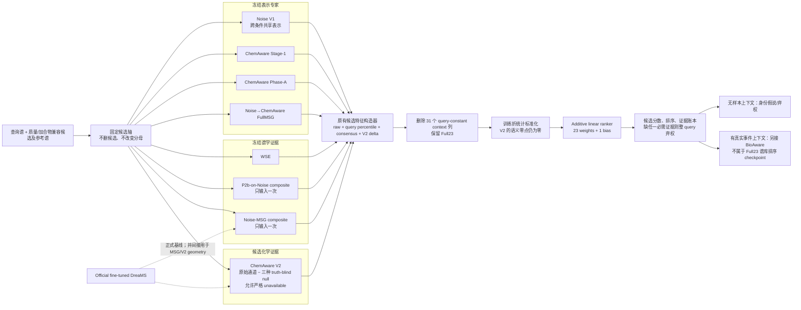

# Unified Additive Full23 v1：架构、完整指标与发布包

日期：2026-10-27

固定模型：`Full23 Additive`

选择作业：`enveda_no_query_context_diagnostic_run_2413878`

严格重拟合消融：`enveda_unified_additive_ablation_run_2415768`

checkpoint SHA-256：`7f1309e2a89ef3640d9b6871a821df6866f2528e629547075d5305ab6707d717`

## 1. 结论

当前最好的可迁移统一候选排序器是 **Full23 Additive**，不是旧 checkpoint
中仍保留的非线性 arm。它把已有的冻结表示、谱学和候选化学证据投到同一
候选轴，经过原有特征构造器得到 23 个候选级特征，再由一个 23 输入、1
输出的线性层形成最终候选分数。最后一层只有 24 个参数（23 个权重和 1 个
bias）；所有上游 encoder 和 reranker 均保持冻结。

它在四个大开发面板上均超过 official fine-tuned DreaMS 和 WSE。相对
official DreaMS 的 Recall@1 增量为 `+24.492/+18.877/+2.892/+2.718 pp`
（Enveda identity/formula、GNPS identity/formula）；相对 WSE 为
`+4.564/+1.028/+0.882/+1.255 pp`。四个公式簇配对区间下界均大于零。

这是一项很强的跨来源开发结果，但不是未开封外部 SOTA 结论：MassSpecGym、
GNPS 和 Enveda 均已参与过项目开发或模型选择。正确表述是 **当前冻结的、
跨来源有效的开发候选**；最终 SOTA 主张仍需全新独立数据一次性确认。

## 2. 固定架构



### 2.1 Noise 微调是否真正进入了系统

是，而且不是只在文档中出现：

- `Noise V1` 直接贡献 raw cosine 和 query-percentile 两列；
- `P2b-on-Noise` 以完整冻结 composite 再贡献两列；
- `Noise→ChemAware FullMSG` 是另一套从 Noise 出发续训的 encoder，贡献两列；
- Noise 还参与冻结 Noise-MSG composite 的上游构造。

Stage-1、Phase-A 与 FullMSG 分别登记、分别打分，没有混成一个
`chemaware_encoder`。Official fine-tuned DreaMS 不作为第八个顶层专家重复
计票，但它确实通过冻结 MSG composite 和 V2 selector geometry 间接进入
上游证据链。

### 2.2 23 个最终特征

| 证据族 | 列数 | 特征 |
|---|---:|---|
| 冻结表示 | 8 | Noise V1、Stage-1、Phase-A、Noise-ChemAware FullMSG 各自的 raw cosine 与 query percentile |
| 直接/局部谱学 | 6 | WSE、P2b-on-Noise composite、Noise-MSG composite 各自的 raw score 与 query percentile |
| 专家共识 | 3 | Top-1 vote fraction、mean percentile、percentile standard deviation |
| ChemAware V2 | 6 | availability、original-minus-zero、original-minus-worst-null、null spread、delta percentile、delta top-gap |
| **合计** | **23** | 由原始 54 列按固定 `exclude_query_constant_context_v1` 策略删除 31 个 query 内常数列 |

V2 字段中的 `candidate_utility_correct` 是“原始/未扰动化学策略通道”，不是
利用真值标签指定“正确候选”。它与 zero、reversed、rotated（候选错配）三种
truth-blind null 比较。V2 不可用时调用原 core 的严格零作用函数；不能拿缺失
值冒充反证。

### 2.3 训练和推理合同

- Enveda 两面板共同做 5 个 global formula folds；同一分子式不能跨训练折和
  验证折，同一 query 在两面板重复出现时总训练权重仍为 1。
- 目标为 query-balanced listwise softmax cross-entropy，加
  `0.01 ×` query-balanced WSE residual penalty。
- AdamW：learning rate `1e-3`、weight decay `1e-4`、20 epochs、每批 256 个
  unique queries、gradient clip 5、seed `20261026`；没有结果后网格搜索。
- Enveda OOF 后做全 Enveda refit；GNPS 仅用该固定 checkpoint 推理，本次执行
  中不在 GNPS 拟合。但 GNPS 历史上已经被项目反复查看，故仍属于 consumed
  development。
- 每个 query 的候选集合和并列处理固定；所有与阳性同分的候选都计在阳性
  之前，即 ties count against the positive。
- 推理时任一必需专家在一个非空 query 内缺失，整 query 弃权而不是删掉该
  candidate；零候选和单候选分别保留并显式标记。

## 3. 数据规模与抽样性质

| 数据集/面板 | queries | 独立身份 | 公式簇 | 候选分子记录 | near queries | 构造 |
|---|---:|---:|---:|---:|---:|---|
| Enveda identity-disjoint | 25,000 | 24,544 | 8,454 | 668,458 | 22,422 | 满足条件者用固定 seed 的确定性 hash 顺序截到 25,000；不是结果后随机抽样 |
| Enveda formula-disjoint | 9,435 | 8,924 | 4,426 | 58,757 | 6,833 | 全部合格 query |
| GNPS identity-disjoint | 10,995 | 5,534 | 4,204 | 87,518 | 7,592 | 全部合格身份，最多 2 个 query/identity |
| GNPS formula-disjoint | 5,261 | 2,662 | 2,210 | 24,401 | 2,944 | 全部合格 query |

Enveda 源文件含 1,175,202 张谱；GNPS 原始扫描 2,091,446 条记录，清洗后保留
329,607 张谱。两面板存在 query 重叠，不能把面板 query 数直接相加当成独立
样本；query-balanced 合并后 Enveda 为 30,343、GNPS 为 11,019 个 unique
queries。

这些分母足以给当前任务得到较窄的公式簇 bootstrap 区间，绝不是几十或几百
query 的小实验；但它们是封闭候选集、确定性 eligibility panel，也不是总体
随机抽样。样本量解决统计精度，不自动解决来源独立性或真实开放集外推。

## 4. 核心性能总表

### 4.1 Recall@1：主要方法同轴比较

所有数字为百分比。

| 面板 | Official DreaMS | Noise V1 | P2b-on-Noise | WSE | **Full23 Additive** | Full − Official | Full − WSE |
|---|---:|---:|---:|---:|---:|---:|---:|
| Enveda identity | 53.100 | 55.536 | 71.876 | 73.028 | **77.592** | **+24.492** | **+4.564** |
| Enveda formula | 67.207 | 69.528 | 84.388 | 85.056 | **86.084** | **+18.877** | **+1.028** |
| GNPS identity | 85.357 | 86.558 | 87.131 | 87.367 | **88.249** | **+2.892** | **+0.882** |
| GNPS formula | 86.809 | 88.063 | 88.253 | 88.272 | **89.527** | **+2.718** | **+1.255** |

GNPS 内部 nested-OOF 的 B 为 88.595/89.850%，比 Full23 高
0.346/0.323 pp；但 B 的学习目标和训练来源就是 GNPS，而冻结 B 到 Enveda
并未保持对 WSE 的收益。Full23 的选择理由是跨来源保持正增量，不是宣称它
在每一张已消费开发表上都绝对最高。

### 4.2 Full23 完整排序指标

| 面板 | R@1 | R@2 | R@3 | R@5 | R@10 | R@20 | MRR | mean rank | median rank |
|---|---:|---:|---:|---:|---:|---:|---:|---:|---:|
| Enveda identity | **77.592** | 91.076 | 95.132 | 97.920 | 99.436 | 99.848 | **86.584** | 1.5040 | 1 |
| Enveda formula | **86.084** | 96.354 | 98.548 | 99.618 | 99.958 | 99.989 | **92.260** | 1.2069 | 1 |
| GNPS identity | **88.249** | 93.943 | 95.989 | 97.481 | 98.890 | 99.754 | **92.379** | 1.4243 | 1 |
| GNPS formula | **89.527** | 95.666 | 97.624 | 98.974 | 99.658 | 99.962 | **93.682** | 1.2376 | 1 |

### 4.3 AUC、AUPRC 与 near 难例

| 面板 | macro AUROC | macro AUPRC | micro AUROC | micro AUPRC | near n | near R@1 | near MRR | mean Top1–Top2 margin |
|---|---:|---:|---:|---:|---:|---:|---:|---:|
| Enveda identity | 97.522 | 86.584 | 97.921 | **66.279** | 22,422 | **75.872** | 85.542 | 2.8579 |
| Enveda formula | 95.441 | 92.260 | 96.138 | **80.324** | 6,833 | **82.175** | 90.079 | 4.2821 |
| GNPS identity | 94.849 | 92.379 | 95.759 | **84.475** | 7,592 | **83.693** | 89.423 | 9.3331 |
| GNPS formula | 94.472 | 93.682 | 95.266 | **87.395** | 2,944 | **82.201** | 89.278 | 10.0630 |

这里每个 query 恰有一个阳性，因此 macro query AUPRC 数学上等于 MRR；不应
把两者写成两个独立胜利。Full23 相对 WSE 的 micro AUPRC 增量分别为
`+9.688/+8.630/+8.848/+9.309 pp`。不同方法的原始 score 尺度不同，margin
只用于同一模型内诊断，不能拿绝对值跨方法比较。

### 4.4 配对纠错、引错与公式簇区间

| 面板/对照 | ΔR@1 (pp) | corrected | introduced | corrected − 2×introduced | 95% formula-cluster CI (pp) |
|---|---:|---:|---:|---:|---:|
| Enveda identity vs Official | **+24.492** | 7,247 | 1,124 | 4,999 | [23.817, 25.156] |
| Enveda formula vs Official | **+18.877** | 2,069 | 288 | 1,493 | [17.932, 19.807] |
| GNPS identity vs Official | **+2.892** | 497 | 179 | 139 | [2.386, 3.405] |
| GNPS formula vs Official | **+2.718** | 238 | 95 | 48 | [1.963, 3.494] |
| Enveda identity vs WSE | **+4.564** | 1,889 | 748 | 393 | [4.138, 4.999] |
| Enveda formula vs WSE | **+1.028** | 283 | 186 | -89 | [0.572, 1.497] |
| GNPS identity vs WSE | **+0.882** | 184 | 87 | 10 | [0.577, 1.208] |
| GNPS formula vs WSE | **+1.255** | 98 | 32 | 34 | [0.783, 1.750] |

因此不能只报平均涨点：Enveda formula 虽然 R@1 和配对 CI 都为正，但在把
每个新错误罚两倍的特定 utility 下为负。该 utility 是额外风险视角，不应
追溯替代已固定的主排序终点。

按 unique-query 权重合并，Full23 相对 WSE：

- Enveda：79.312% vs 75.398%，`+3.914 pp`，95% CI
  `[+3.545,+4.278]`；MRR 87.730%。
- GNPS：88.284% vs 87.426%，`+0.858 pp`，95% CI
  `[+0.540,+1.178]`；MRR 92.421%。

## 5. 自研资产是否真的有增量

严格消融不是推理时把列置零，而是删除一个证据族、重算派生特征、沿用同一
折与训练设置重新拟合。下表为 `Full23 − 对应 refit ablation` 的 Recall@1
差值与公式簇 95% CI（pp）。

| 删除的证据族 | Enveda identity | Enveda formula | GNPS identity | GNPS formula |
|---|---:|---:|---:|---:|
| Stage-1 + Phase-A + FullMSG 表示组 | +1.300 [1.004,1.590] | +0.011 [-0.328,0.337] | +0.045 [-0.138,0.225] | +0.133 [-0.151,0.417] |
| ChemAware V2 continuous-null | **+0.748 [0.473,1.032]** | **+0.435 [0.151,0.721]** | **+0.628 [0.377,0.879]** | **+0.912 [0.544,1.269]** |
| P2b + MSG 局部谱学组 | +0.384 [0.200,0.577] | -0.095 [-0.368,0.187] | +0.227 [0.027,0.443] | +0.361 [0.076,0.672] |

最稳定的独立贡献来自 V2：四个面板均为正且 CI 下界大于零。新增 ChemAware
表示组在 Enveda identity 有明确价值，但其余三个面板未证明独立增量；局部
P2b/MSG 在三个面板为正、Enveda formula 不支持增量。系统保留这些既有证据，
但论文不能声称每个分支在所有来源都独立有效。

更关键的低容量对照是只用 **Official DreaMS + WSE** 重新训练同一 Additive。
Full23 仍提高 `+2.760/+0.827/+0.809/+1.083 pp`，四个公式簇 CI 下界均为正。
因此目前的收益不能被“把两个现成强基线学个权重”完全解释。

## 6. 发布包：只封装，不重写

发布目录 `deploy/unified_additive_full23_v1` 和可转移 archive 都调用原来的：

- `enveda_unified_candidate_integrator_core.py`；
- `massspecgym_embedding_readout_core.py`；
- 原始 checkpoint 中显式指定的 `additive_linear_control` arm。

封装层只做五件事：固定 checkpoint/arm/23 列顺序，验证候选轴与上游工件
身份，处理 V2 的 real/unavailable 合同，执行 whole-query 缺失弃权，以及写出
不丢行的逐候选/逐 query 结果。它没有重写特征数学、网络或训练。

包内包括：

- 冻结 checkpoint；
- 薄推理封装和两份原始 core；
- evidence manifest 模板；
- 所有上游 encoder/reranker/policy 的路径、角色、参数和 SHA-256 注册表；
- 四份逐字节复制的原始选择、固定迁移和严格消融报告；
- 全文件 `SHA256SUMS.txt`、golden replay test 和 bundle validator；
- 本文档。

大 encoder 没有在每个小包里重复复制；当前 archive 是明确标注的
**decision-layer profile**。原始谱图到七路候选证据的生产链仍依赖仓库和外部
大权重，manifest 已逐项登记但不虚称完整可移植环境。只要七路候选证据按
固定轴生成，决策层仅需 NumPy/PyTorch 即可运行。

运行：

```bash
python -u tasks/unified_additive_release.py \
  --evidence candidate_evidence.npz \
  --evidence-manifest candidate_evidence.json \
  --output unified_additive_predictions \
  --device cpu
```

构建和验证：

```bash
python -u tasks/build_unified_additive_release_bundle.py \
  --output deliverables/unified_additive_full23_v1_20261027 \
  --archive

python -u tasks/validate_unified_additive_release_bundle.py \
  deliverables/unified_additive_full23_v1_20261027
```

## 7. 文章级表述边界

可以写：

> 冻结的多表示、局部谱学和候选化学证据，经一个低容量候选级 Additive
> 判决层整合后，在两个大规模 consumed-development 来源的四个面板上均超过
> official fine-tuned DreaMS 和 WSE；严格重拟合表明自研资产整体以及 V2
> chemical-null evidence 提供了不能由 Official+WSE learned Additive 完全
> 替代的增量。

现在不能写：

- “已经完成全领域外部 SOTA”；
- “所有模块在所有来源都有独立增量”；
- “BioAware 已包含在 Full23 排名器”；
- “提升来自复杂非线性交互”；
- “AUC 提升自动等于真实开放集身份可靠性”。

下一项真正改变证据等级的工作，不是在 GNPS/Enveda 上再调一个融合头，而是
把这个 SHA 固定的包用于全新来源、开放集拒判和真实样本实体恢复；BioAware
只在合法的事件级样本上下文存在时接到排序结果之后。
