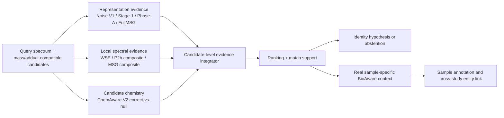

# Unified candidate-evidence architecture: implementation record

## Fixed system

The project now has one architecture, rather than a sequence of unrelated
fusion experiments:



`Stage-1`, `Phase-A`, and `FullMSG` retain separate identities. `P2b` and the
historical Noise-MSG model each enter once as a complete composite; their
primitive channels are not reintroduced beside them. ChemAware V2 enters as
continuous correct-chemistry minus matched-null evidence with explicit
availability. It is not the old hard promotion action.

Official fine-tuned DreaMS (`embedding_model.ckpt`, represented by the
`official_dreams` channel) and the existing B ranker are formal comparators.
The raw SSL checkpoint supplies architecture only and is not substituted for
the fine-tuned baseline. Official evidence is already used inside the frozen
MSG expert, while B reuses WSE/Noise/P2b/V2 and would duplicate the fitted
inputs. RRF remains a retired audit result and is not in this fixed
architecture.

## Training and decision implementation

The runnable model is implemented in:

- `tasks/enveda_unified_candidate_integrator_core.py`
- `tasks/train_enveda_unified_candidate_integrator.py`
- `tasks/evaluate_enveda_integrator_on_gnps.py`
- `tasks/run_enveda_unified_candidate_integrator_2gpu.sbatch`

The continuous WSE score is the ranking anchor. A hidden-16 nonlinear residual
learns label-blind reliability and dependency patterns among the frozen
experts. Its residual is not hard bounded; a query-balanced anchor penalty
controls its magnitude. A linear model with the same inputs is reported only
as a lower-capacity additive comparator. The nonlinear primary is declared in
advance and is never selected against the linear comparator after seeing OOF
metrics.

Enveda-180 is now a **consumed meta-development set**, not an external test.
Its identity and formula panels are cross-fitted with one global formula split.
The candidate ledgers remain separate. Repeated source queries stay in the
same fold, remain an indivisible training batch unit, and have total weight
one across panel occurrences. Normalization is fitted inside each training
fold. Panel identity is not a feature.

The required families are the four encoder scores, WSE, P2b composite, and MSG
composite. Missing required evidence fails closed. V2 is the only optional
family: without a legal candidate-structure context, availability and every
continuous V2 field are exactly zero. BioAware is not fabricated on Enveda or
GNPS; it is applied only after the spectral/chemical decision on a real sample
axis.

After Enveda cross-fitting, one all-Enveda refit is written. GNPS is then read
once for a fixed comparison and cannot change the model, inputs, arm, or
normalization. Both resources are already consumed development data. A new,
genuinely independent collection is still required for a final SOTA claim.
MassSpecGym is not used to select this new integrator because the upstream
project encoders have incompatible and heavily overlapping MassSpecGym
training histories.

## Server entry and outputs

Run exactly:

```bash
sbatch tasks/run_enveda_unified_candidate_integrator_2gpu.sbatch
```

The job requests two GPUs and 20 CPU cores, reuses the existing Enveda
fine-tuned-official/Noise scoreblind caches, creates only the missing Stage-1,
Phase-A, FullMSG, MSG and continuous-V2 evidence, fits the fixed model, then performs
the fixed GNPS comparison. Reusable artifacts are accepted only when their
frozen benchmark/cache contracts match; ambiguous fallback directories fail
instead of selecting the newest one, and the B comparator must match every
query and candidate axis rather than merely having the same length. Its result
directory contains:

The execution path performs no network download. `official_dreams` is reused
from the frozen score bundles generated with the local official fine-tuned
`embedding_model.ckpt`; the SSL architecture checkpoint is never substituted
for that baseline.

- `modeling/report.json`: Enveda OOF results and query-balanced accounting;
- `modeling/candidate_predictions_oof.npz`: per-candidate OOF ledger;
- `modeling/unified_candidate_integrator.pt`: all-Enveda deployment refit;
- `gnps_fixed_evaluation/report.json`: fixed, no-refit GNPS comparison;
- `gnps_fixed_evaluation/candidate_scores_*.npz`: per-candidate GNPS scores;
- `SHA256SUMS.txt`: hashes of the decision artifacts.

The application scorer uses the same candidate axis and model feature
contract. Zero-candidate queries remain explicit abstentions, one-candidate
queries remain representable, and a missing required expert makes the whole
affected query block abstain rather than changing its candidate universe.
BioAware consumes the stable `candidate_pair_id` ledger downstream so that a
real context, an absent context, and a permuted context can be compared on the
same candidates.

## Current claim status

The architecture and executable path are complete; performance is not known
until the server job returns. Therefore no statement that the system is SOTA,
that nonlinear interaction is superior, or that BioAware improves ranking is
made in advance. Promotion requires the Enveda OOF and fixed GNPS reports plus
the same model's entity-level application output. Final generalization still
requires an untouched external dataset.
