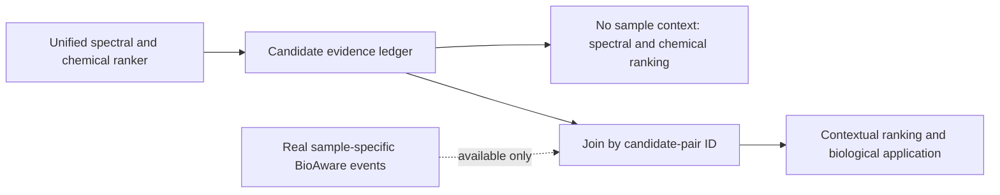

# 大一统候选排序器：真实架构、完整结果与 SOTA 裁决

日期：2026-10-26

主工件：`data/validation/massspecgym_unified_ranker_run_2409612`

固定模型：`modeling/selected_readout.pt`，SHA256 `3c841bc57ee2664e87d8cb3418ab86452d2f24e479dae59a897dde596deeb79f`

## 一句话结论

这次已经实现了一个真正的候选级统一排序器：WSE、Noise V1、冻结 P2b、ChemAware V2、ChemAware Stage-1、Phase-A 和 Noise→ChemAware FullMSG 都有实际计算路径，四个 encoder 的完整 1024 维表示也确实被读取，而不是只把模块名字写入注册表。

但是，**当前版本不是 SOTA**：

- 在 MassSpecGym corrected 10-ppm 开发图的 held formula fold 上，`embedding_pair` 的 Recall@1 点估计最高，为 `95.4126%`；但相对容量匹配的标量系统仅 `+0.0764 pp`，公式簇同步区间跨零，且风险净值为负。
- 在已消费的 GNPS 固定评测上，它没有确认超过 WSE、Noise 或 P2b，并且在完全相同候选轴上明显低于项目当前冠军 B：identity/formula Recall@1 分别低 `1.4825/1.1785 pp`。
- MassSpecGym、GNPS 和 Enveda 均已被项目开发或查看消费，当前没有新的独立外部数据支持泛化或公开 SOTA 主张。

正确表述是：**大一统工程骨架已经形成；标量多证据整合在 MassSpecGym 开发域有效；“完整 embedding 产生独立增量”与“跨域优于已有冠军”均尚未成立。**

## 证据边界

| 数据 | 分母 | 本轮用途 | 项目级状态 | 可支持的结论 |
|---|---:|---|---|---|
| MassSpecGym corrected 10-ppm graph | 总计 83,619 queries；folds 1–4 训练 65,286；fold 0 选择 18,333 | 训练三个 readout、选择 full-embedding arm、随后全图重拟合 | development / consumed | 开发集内部的模块与 readout 比较；不是外部确认 |
| GNPS identity-disjoint | 10,995 queries，87,518 candidate molecules | MassSpecGym 选模后固定推理；本作业不拟合 | development / consumed | 固定迁移评测；不是新的外部确认 |
| GNPS formula-disjoint | 5,261 queries，24,401 candidate molecules | 同上 | development / consumed | 同上；面板名称不是部署路由条件 |
| Enveda-180 | 已打开过 | 本作业未读取 | consumed | 不能再次作为新模型的最终外测 |

MassSpecGym 的 `95.4126%` 只来自 18,333-query held fold。最终模型随后用全部 83,619 queries 重拟合，因此不能再把全图训练内成绩写成无偏评测。

## 当前真实架构

```mermaid
flowchart TB
    Q[Query spectrum] --> G[Fixed 10-ppm candidate graph]
    G --> M[Candidate molecule]
    M --> R[All reference spectra of that molecule]

    R --> S1[Noise V1 cosine molecule-max]
    R --> S2[Weighted spectral entropy molecule-max]
    R --> S3[Frozen P2b-on-Noise composite molecule-max]
    R --> E1[Noise V1 1024-d embedding]
    R --> E2[ChemAware Stage-1 1024-d embedding]
    R --> E3[ChemAware Phase-A 1024-d embedding]
    R --> E4[Noise-to-ChemAware FullMSG 1024-d embedding]
    M --> C[ChemAware V2 continuous correct-vs-null evidence]

    S1 --> X[30-d scalar evidence block]
    S2 --> X
    S3 --> X
    C --> X
    E2 --> X
    E3 --> X
    E4 --> X

    X --> A0[Scalar MLP control\n73,441 parameters]

    E1 --> P1[Independent 1024 to 16 projection]
    E2 --> P2[Independent 1024 to 16 projection]
    E3 --> P3[Independent 1024 to 16 projection]
    E4 --> P4[Independent 1024 to 16 projection]

    P1 --> PC[Projected-cosine arm\n72,001 parameters]
    P2 --> PC
    P3 --> PC
    P4 --> PC
    X --> PC

    P1 --> PH[Symmetric pair head\nabs(q-r) plus q*r]
    P2 --> PH
    P3 --> PH
    P4 --> PH
    X --> PH
    PH --> OUT[Selected embedding-pair score\n74,181 parameters]
```

### 30 维标量证据

1. Noise V1、WSE、冻结 P2b 各自的 molecule-max raw score 与 query 内 percentile：6 维。
2. 候选分子数、参考谱边数、边数对数，三个家族的 Top1–Top2 gap，以及三组两两 Top-1 agreement：9 维。
3. Stage-1、Phase-A、FullMSG 各自的 raw cosine、percentile、top gap：9 维。
4. ChemAware V2：availability、correct−zero、correct−worst-null、null spread、可用候选内 percentile 与 top gap：6 维。

V2 不可用时，availability 为 0，其余五项严格为 0；V2 残差只按训练行 RMS 缩放、不中心化，因此缺失零点不会被标准化伪造成化学证据。P2b 只输入冻结 composite，没有同时重复输入 entropy、sqrt cosine 或 neutral-loss 子通道。

### 完整 embedding 怎样进入

- 四个 encoder 各自使用独立的 `1024→16` 无偏置投影，不假设不同 encoder 的维度语义对齐。
- `projected_cosine` 对每个投影后的 query/reference 向量计算一个 cosine，再与标量 hidden 合并。
- `embedding_pair` 对每个 encoder 构造 `|q-r|` 与 `q*r`，经独立 pair head 压成一个标量；四个 encoder 标量再与标量 hidden 合并。
- 每个 encoder 会为同一候选分子独立选取原始 cosine 最高的参考谱，因此不同 encoder 可以读取不同 reference row。

所以该系统确实读取了完整 embedding，但它不是联合训练的统一 encoder，也不是跨 encoder 的向量级交互模型：每个 encoder 在最终融合前仍被压成一个标量。

### 本次没有进入主排序器的资产

- official DreaMS 分数；
- 历史 Noise MSG reranker 输出（`FullMSG` 在这里是 encoder，不是旧 MSG 重排分数）；
- 已退役 RRF；
- P2b 原始三个子通道；
- ChemAware V2 hard-promotion 动作；
- 历史 B 的分数或模型；
- BioAware 样本事件；
- open-set abstention。

BioAware 仍属于统一系统的真实样本上下文模式，但当前谱库训练和两个 GNPS 面板没有合法样本事件，因此它不能被伪造成一个常数分数加入本轮模型。

系统级运行方式因此应分成两个合法模式，而不是在所有数据上强塞 BioAware：



第一条路径已由本轮模型实际运行；第二条路径已有 candidate-pair 交接接口，但 BioAware 对最终分数的独立增量尚未完成验证。因此它属于大一统算法的条件扩展，不属于本轮 GNPS 性能数字。

## MassSpecGym held-development 结果

数据：held formula fold 0，`n=18,333` queries；`88,197` candidates；`1,249` formula clusters；near `n=6,781`。角色：development / consumed。所有公式簇区间均为 24 个登记假设下的同步区间。

| 方法 | R@1 | R@2 | R@5 | MRR | near R@1 |
|---|---:|---:|---:|---:|---:|
| WSE | 93.3453% | 98.0091% | 99.6509% | 0.962094 | 88.4973% |
| P2b-on-Noise | 93.9017% | 98.0800% | 99.8255% | 0.965347 | 89.2789% |
| Noise V1 | 94.2781% | 98.4018% | 99.7982% | 0.967889 | 89.4263% |
| Stage-1 | 93.8744% | 98.4018% | 99.8855% | 0.965999 | 88.6005% |
| Phase-A | 94.2399% | 98.4018% | 99.8418% | 0.967809 | 89.1314% |
| Noise→ChemAware FullMSG | 95.0908% | 98.8873% | 99.9073% | 0.973072 | 90.6356% |
| Scalar evidence control | 95.3363% | 98.8109% | 99.9018% | 0.974128 | 90.9010% |
| Projected cosine | 95.3908% | 98.8327% | 99.8909% | 0.974463 | 90.9895% |
| **Embedding pair** | **95.4126%** | **98.9254%** | 99.8691% | **0.974730** | **91.1223%** |

### 真正被结果支持的增量

| 比较 | ΔR@1 | corrected / introduced | risk = corrected−2×introduced | 同步公式簇区间 |
|---|---:|---:|---:|---:|
| Pair vs WSE | +2.0673 pp | 619 / 240 | +139 | [+1.2776, +3.0356] pp |
| Pair vs P2b | +1.5109 pp | 493 / 216 | +61 | [+0.8584, +2.3263] pp |
| Pair vs Noise V1 | +1.1346 pp | 293 / 85 | +123 | [+0.6604, +1.7464] pp |
| Pair vs Phase-A | +1.1727 pp | 450 / 235 | −20 | [+0.4749, +1.9013] pp |
| Pair vs FullMSG | +0.3218 pp | 270 / 211 | −152 | [−0.2916, +1.0028] pp |
| **Pair vs scalar control** | **+0.0764 pp** | **152 / 138** | **−124** | **[−0.3055, +0.4652] pp** |
| Pair vs projected cosine | +0.0218 pp | 110 / 106 | −102 | [−0.3339, +0.3984] pp |

这组结果把“模块整合有效”和“完整向量读出有效”分开了：

- 多证据标量系统相对 WSE、P2b 和 Noise 有确认增益；这是当前最坚实的统一排序正结果。
- 完整 embedding 相对同容量、同输入标量控制只多 14 个净 Top-1，区间跨零，不能说完整表示已经带来独立增量。
- Pair 相对最强单 encoder FullMSG 也未确认胜出。
- Pair 的净 Top-1 收益全部来自 near 子集：near 为 101 corrected / 86 introduced，非-near 为 51 / 52。
- 描述性、post-hoc 诊断中，正确候选具有 V2 化学证据的 1,176 queries 上，Pair 相对 scalar 为 41 / 89，净损 48；V2 不可用的 17,157 queries 为 111 / 49，净增 62。它不能作为预注册机制结论，但明确不支持“完整表示与 V2 已产生协同”。

候选级辅助指标也不是 Pair 全面占优：micro AUROC/AUPRC 为 scalar `0.97994/0.93083`、projected `0.99075/0.96980`、pair `0.98634/0.93997`。Pair 只是预先指定的 Top-1/MRR 选择终点冠军；projected cosine 在候选判别 AUC 上更好。因此，替换 cosine 是次要的、尚未解决的读出问题，不是当前统一算法胜利的来源。

## GNPS 固定迁移结果

本作业在 MassSpecGym 完成选模和全图重拟合后才读取 GNPS；GNPS evaluator 没有 optimizer、阈值搜索、路由或选模分支。但 GNPS 在整个项目中早已被反复使用，故仍必须标记为 development / consumed，而非新的外部确认。

| 面板 | 方法 | R@1 | MRR | near R@1 | macro-query AUROC |
|---|---|---:|---:|---:|---:|
| Identity, n=10,995 | WSE | 87.3670% | 0.916604 | 82.5079% | 0.943283 |
|  | P2b | 87.1305% | 0.916458 | 82.1259% | 0.944376 |
|  | **本次统一模型** | **87.1123%** | **0.917132** | **82.0996%** | **0.946763** |
|  | B，GNPS nested formula-OOF | **88.5948%** | **0.927246** | **84.1149%** | **0.954937** |
| Formula, n=5,261 | WSE | 88.2722% | 0.927962 | 80.0951% | 0.938964 |
|  | P2b | 88.2532% | 0.929002 | 80.0611% | 0.940072 |
|  | **本次统一模型** | **88.6714%** | **0.932119** | **80.7405%** | **0.944280** |
|  | B，GNPS nested formula-OOF | **89.8498%** | **0.939368** | **82.7106%** | **0.951860** |

本次统一模型相对 WSE：

- Identity：`−0.2547 pp`，363 corrected / 391 introduced，risk `−419`，同步公式簇区间 `[−1.1034,+0.5366] pp`。
- Formula：`+0.3992 pp`，208 / 187，risk `−166`，区间 `[−0.8433,+1.8274] pp`。

所有对 WSE、Noise、P2b 的 GNPS Recall@1 区间均跨零，且全部 risk 为负。Formula 上的正点估计不能替代不确定性，也不能抵消 identity 的下降。

### 与项目冠军 B 的同轴复算

冻结 OOF B 来自 `B_dual_encoder_multireranker_run_2400157/modeling_nested_oof/candidate_predictions.npz`，不是在全 GNPS 标签上 refit 后的分数。新模型与 B 的 query pointers、labels、formula、candidate IK14 已逐项对齐后直接复算：

| 面板 | ΔR@1（新模型−B） | corrected / introduced | risk | 同步公式簇区间 |
|---|---:|---:|---:|---:|
| Identity | **−1.4825 pp** | 263 / 426 | −589 | **[−2.2143, −0.7735] pp** |
| Formula | **−1.1785 pp** | 147 / 209 | −271 | **[−2.4085, −0.0656] pp** |

Near 子集也分别低 `2.0153/1.9701 pp`。同一重算器下，B 对新模型的 micro AUROC/AUPRC 为：identity `0.96807/0.80768` 对 `0.95161/0.75945`；formula `0.96091/0.81909` 对 `0.93972/0.77366`。

这也不是“只差 B”：相对历史容量匹配的简单加法 C，新模型 identity 低 `1.3643 pp`（274 / 424，risk `−574`，同步区间 `[−2.1222,−0.6029] pp`），formula 低 `0.9694 pp`（158 / 209，risk `−260`，区间 `[−2.1583,+0.1850] pp`）。因此 GNPS identity 已直接否定当前 full-embedding readout 相对简单加法的晋级资格。

B 是在 GNPS 内 nested formula-OOF 训练的开发模型，而本次统一模型是在 MassSpecGym 训练后固定迁移；两者不代表相同的零样本条件。但是，对“项目当前最强开发算法是谁”这个问题，答案仍然是 B，而不是本次 full-embedding ranker。

## 是否 SOTA：分层裁决

| 主张层级 | 裁决 | 原因 |
|---|---|---|
| 本项目 MassSpecGym custom graph 点估计最佳 | 是，限定为 held-development Top-1 点估计 | Pair 95.4126%，但只比 scalar 高 0.0764 pp，未确认 |
| 本项目 MassSpecGym 机制确认 | 否 | Full embedding vs scalar 和 vs FullMSG 的区间均跨零，risk 为负 |
| 本项目 GNPS 最佳 | 否 | 同轴显著低于 B；identity 还低于 WSE |
| 独立外部泛化 | 否 | MassSpecGym/GNPS/Enveda 均已消费 |
| 公开 MassSpecGym leaderboard SOTA | 不可比较，不能主张 | 本项目是谱图到参考谱身份检索；官方 benchmark 是谱图到分子结构候选检索 |
| 领域通用 SOTA | 否 | 没有公共同协议 benchmark、独立外测和公开方法复现 |

公开 MassSpecGym molecule-retrieval 给每个 query 的候选是分子图，并要求对结构分离测试集做检索；我们的 corrected graph 要求真实候选已有参考谱，并对谱图—谱图身份匹配取 molecule-max。两者的 `Recall@1` 不是同一个统计量。当前公开工作中，FLARE 用峰—原子细粒度对齐报告 MassSpecGym mass/formula Rank@1 `43.15%/22.66%`；更新的 GLACIER v2 用分子到谱图预测报告约 `69.95%/49.88%`。这些数字都不能与本项目的 `95.41%` 横向相减。

## 调研后对架构的再判断

### 做对了什么

1. **相关证据家族没有重复计票。** P2b composite 与子通道不共存，RRF 没有复活。
2. **四个 encoder 保持独立身份。** Stage-1、Phase-A、FullMSG 没再被合并成模糊的 `chemaware_encoder`。
3. **化学证据有反事实零点。** V2 使用 correct 相对 matched null 的连续差异，而不是把 hard action 当普适真理。
4. **完整表示确实被读取。** Pair head 使用全部 1024 维输入，不是只把历史 cosine 再送入 MLP。
5. **有容量匹配控制。** 因此可以知道主要增益来自多证据标量系统，而不是完整 embedding 几何。

### 当前为什么没有兑现完整表示

1. **learned metric 之前先用 raw cosine 选了唯一 reference。** 如果真正有价值的参考谱不是 raw-cosine 第一名，后续 pair head 永远看不到它。当前最关键的信息损失发生在 learned readout 之前。
2. **每个 encoder 过早压成一个标量。** 四个 1024→16 pair 表示没有互相作用；模型只能融合四个最终数字，无法学习“Noise 的条件稳健方向与 ChemAware 的化学方向如何共同支持同一候选”。
3. **同分子多参考谱被 hard max 丢弃。** 没有利用多谱一致性、碰撞能稳定性或跨仪器邻域，这恰是 Noise 表示最应贡献的部分。
4. **训练终点和使用风险分离。** Listwise CE 可改善平均排序，但不会自动限制 introduced errors；GNPS 的负 risk 正是这一点的外部表现。
5. **full arm 被强制选择。** Scalar 即使更可靠也不能成为最终模型；因此“生成了 full 模型”不等于“full 表示增量已通过”。
6. **数据轴锁仍需一次性补严。** 部分化学/base-score loader 只核 shape 或 pointer，没有统一核 candidate IDs/order；在下一次正式运行前应补主键断言，而不是再建一套审计项目。

这些判断与近期文献方向一致，但不是从文献替代实验得出的结论。DreaMS 证明大规模自监督谱图表示能够编码结构；MS2DeepScore 2.0 和 Spec2Vec 表明 learned similarity 可超越传统 cosine 的部分用途；MVP 说明多视图联合学习有效；FLARE 的主要进展恰是避免把局部谱图/结构信息过早池化为单个全局相似度；GLACIER 则说明强候选排序还可来自高质量分子→谱图建模。我们的结果进一步说明：**仅把多个完整 encoder 分别压成四个 learned scalar，并不足以稳定转化这些互补资产。**

主要调研来源：

- DreaMS: https://doi.org/10.1038/s41587-025-02663-3
- MassSpecGym benchmark: https://papers.nips.cc/paper/2024/hash/c6c31413d5c53b7d1c343c1498734b0f-Abstract-Datasets_and_Benchmarks_Track.html
- MassSpecGym evaluation-pitfall audit: https://arxiv.org/abs/2606.19624
- Spectral entropy: https://doi.org/10.1038/s41592-021-01331-z
- MS2DeepScore 2.0: https://doi.org/10.1038/s41467-026-69083-y
- MVP: https://pubmed.ncbi.nlm.nih.gov/41725427/
- FLARE: https://pmc.ncbi.nlm.nih.gov/articles/PMC12873900/
- GLACIER: https://arxiv.org/abs/2606.29161

## 下一步：只修一个真正的瓶颈

下一轮不再换 cosine 名称、不再加一个标量融合头，也不重新训练四个 backbone。只实现一个固定的 **multi-reference cross-encoder set readout**：

1. 每个候选、每个 encoder 保留固定 Top-K reference pair tokens，而不是 raw cosine 唯一 best reference。
2. Pair token 保留 16 维表示，不在 encoder 内立即压成一个数；用共享的 permutation-invariant pooling 汇总同分子多谱。
3. 四个 encoder token 与 WSE、P2b、V2 证据 token 做一次小型跨家族交互，再产生单一候选分数。
4. 最终采用 `scalar evidence score + bounded representation residual` 的单一可微形式；这不是手工“同意/不同意”路由，而是让完整表示只负责解释相对已经有效的标量系统还能增加什么。
5. BioAware 通过同一 candidate ID 作为真实样本事件 token 加入 context 模式；无合法事件时 masked unavailable，不参与普通谱库排序。
6. 只保留三个固定比较：当前 scalar、当前 pair、multi-reference set readout。MassSpecGym 冻结后一次跑 GNPS；GNPS 只作 consumed stress test，不再据其结果扩展网格。

这一步直接攻击本次已证实的结构瓶颈，同时复用全部现有 embeddings、WSE/P2b/V2 缓存和候选图。它比继续调 cosine、增加 reranker 名称或扩大阈值扫描更有机会把现有资产转化成真正的新算法。

## 最终论文口径

当前可以写：

> We constructed a candidate-level multi-evidence ranker that preserves independent spectral, representation and counterfactual chemical evidence. On a consumed MassSpecGym-derived development graph, the multi-evidence scalar system reliably exceeded individual WSE, Noise and P2b baselines, whereas reading four full embeddings produced only an unconfirmed additional Top-1 point gain. The selected full-embedding readout did not transfer beyond the existing GNPS development champion, identifying premature single-reference selection and per-encoder scalar compression as the next mechanistic bottlenecks.

当前不能写：

- “完整 embedding 融合已显著提高性能”；
- “双/四 encoder 产生协同”；
- “GNPS 外部验证成功”；
- “新算法达到领域 SOTA”；
- “BioAware 已进入并提升普通谱库排序”。
