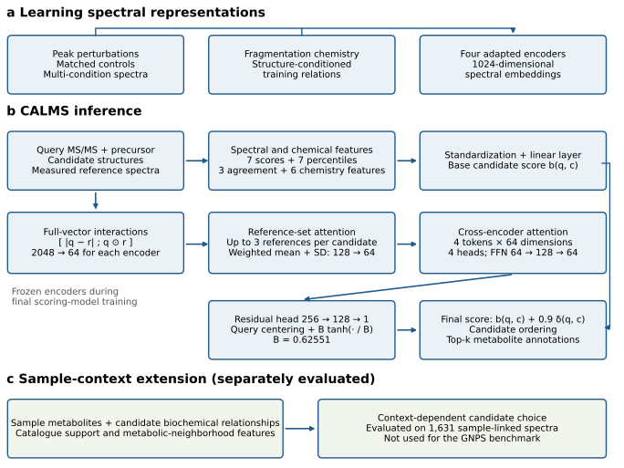
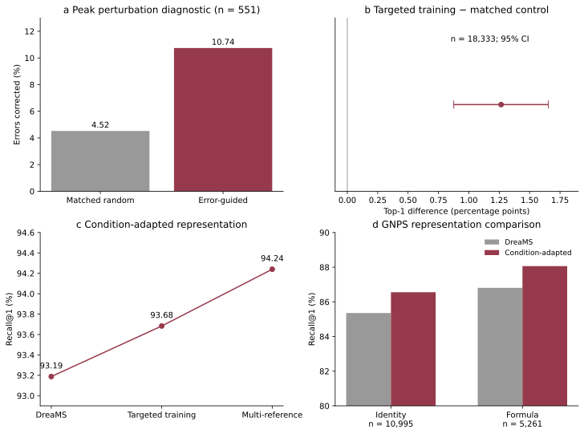
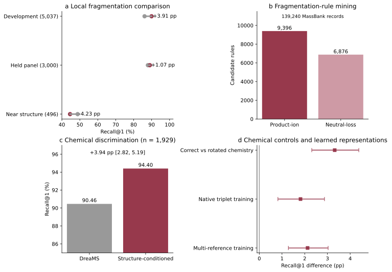
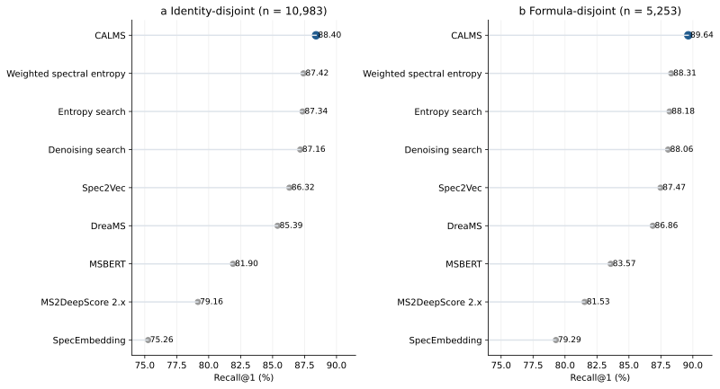
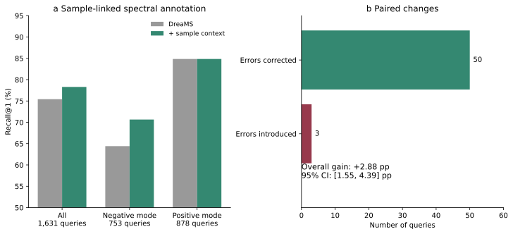

# CALMS: Context-Aware Learning for Metabolite Annotation from Mass Spectra

## Abstract

Metabolite annotation by tandem mass spectrometry is limited by variation in experimental conditions and by the difficulty of distinguishing molecules with similar fragmentation patterns. We present CALMS, a context-aware learning framework that develops condition-robust spectral representations and incorporates fragmentation chemistry into candidate discrimination. Starting from a pretrained spectral encoder, CALMS learns from targeted peak perturbations and multiple measured reference spectra, incorporates structure-conditioned chemical features, and retains full-dimensional query–reference interactions before aggregating reference sets. A complementary sample-context extension examines whether biochemical relationships improve annotation when sample information is available. On a common GNPS comparison comprising 10,983 identity-disjoint and 5,253 formula-disjoint queries, CALMS achieves Top-1 accuracies of 88.40% and 89.64%, respectively, compared with 85.39% and 86.86% for DreaMS and 87.42% and 88.31% for weighted spectral entropy. Candidate-level AUROC reaches 0.959 on the identity-disjoint panel. Separate module experiments support condition-adapted learning and structure-conditioned discrimination; sample context improves accuracy from 75.41% to 78.30% across 1,631 sample-linked queries. These results establish a practical approach to resolving ambiguities among library-supported metabolite candidates. The GNPS results characterize model development performance, while the sample-context results define an additional, separately evaluated capability.

Keywords: tandem mass spectrometry; metabolite annotation; representation learning; fragmentation chemistry; spectral libraries; biochemical context

## 1. Introduction

Liquid chromatography coupled to tandem mass spectrometry provides sensitive measurements of chemically diverse metabolites, but assigning molecular identities to observed spectra remains a central analytical challenge. Community resources such as GNPS have expanded access to reference spectra and enabled their reuse across laboratories [1]. Nevertheless, a measurable spectrum does not necessarily imply an unambiguous molecular annotation. Library coverage, experimental conditions and similarity between candidate structures impose distinct constraints. In particular, a correct structure may already be represented in a reference library yet fail to become the highest-scoring candidate. Improving this discrimination is valuable even without extending the set of structures represented by the library.

Spectral comparison methods address different aspects of this problem. Spectral entropy provides an effective alternative to dot-product comparison by accounting for the distribution of fragment intensities [2]. Denoising Search applies chemical and electronic noise removal to improve library matching [3]. Learned representations offer another route: Spec2Vec models associations among fragment and loss features [4], MSBERT learns spectral embeddings through masked and contrastive objectives [5], and DreaMS learns representations from large collections of tandem mass spectra [6]. MS2DeepScore learns chemical similarity between spectra, including cross-ionization-mode prediction in its recent extension [7]. These methods make spectral similarity more informative, but their objectives differ: chemical similarity, analogue retrieval and exact candidate identity are related tasks with different success criteria.

Information beyond a single global spectral similarity is also relevant. SIRIUS uses fragmentation information to infer molecular formulas and structural properties [8]. MS2Query combines learned spectral similarities and precursor information for exact and analogue searches [9]. Recent multiview learning, exemplified by MVP, links spectra to additional molecular views [10]. These developments motivate a question at the level of the annotation algorithm: how can a representation remain tolerant to experimental variation while preserving the local differences that distinguish closely related candidate molecules? A representation that is useful for broad chemical similarity need not optimally resolve every identity-level ambiguity.

Biochemical context provides a further source of information when spectra originate from a shared sample. MetDNA and subsequent extensions use metabolic relationships to assist annotation across interconnected features [11–13]. Such relationships can constrain plausible candidates, but their usefulness depends on the available metabolite catalogue, ionization mode and network coverage. Their contribution should therefore be measured separately from spectrum-only discrimination before a general claim of biochemical reasoning is made.

CALMS addresses these questions through a progression from experimental-condition adaptation to fragmentation-guided discrimination and, where available, sample-context inference. The spectral component learns from targeted peak perturbations and multiple reference spectra of the same molecule. The chemical component relates observed fragments and neutral losses to candidate structure and to matched control assignments. The final scoring architecture combines these features with full-dimensional query–reference interactions, aggregating reference spectra and adapted representations before producing candidate scores. We evaluate the resulting model against established spectral comparison methods on common candidate sets, examine its component experiments, and separately quantify the sample-context extension. This study concerns annotation among candidate molecules supported by reference measurements; it does not claim de novo structure generation or identification of structures absent from the candidate library.

## 2. Experimental Section

### 2.1. Annotation task and datasets

For a query spectrum q, the task is to identify the correct molecular candidate from a precursor-compatible set C(q). Each candidate is associated with measured reference spectra. Candidate identity is represented by the first block of the InChIKey, so the endpoint concerns molecular connectivity rather than stereochemical identification. Candidate construction uses a 10 ppm precursor tolerance with matched adducts; the main GNPS comparison uses protonated positive-mode spectra. Within a candidate molecule, scalar spectral comparison scores are aggregated over its measured references by taking the maximum. Reference spectra are therefore not counted as independent candidate identities.

The final GNPS comparison contains an identity-disjoint panel with 10,983 queries, 5,528 molecular identities, 4,199 formulas and 87,494 query–candidate pairs, and a formula-disjoint panel with 5,253 queries, 2,658 identities, 2,207 formulas and 24,385 query–candidate pairs. These panel labels describe the partitioning used in construction; a correct query molecule remains represented in the search library by its reference spectra. A common query domain was used for every compared method. Twelve and eight queries, respectively, were removed from the preceding panels because MSBERT could not represent their precursor domain. All candidates for an excluded query were removed together. Earlier module experiments used their own stated panels and are reported with their original denominators.

Encoder development used a MassSpecGym-derived experimental-spectrum retrieval task. This differs from directly reproducing the official MassSpecGym structure-generation or structure-retrieval tasks [14]. The integrated scoring model was trained using Enveda-180 data comprising identity and formula panels of 25,000 and 9,435 queries, with 30,343 unique queries across them. Formula-grouped out-of-fold predictions were used for training and evaluation of the scalar scoring component. GNPS subsequently informed architecture and residual-amplitude selection; consequently, the final GNPS comparison measures development performance rather than a newly untouched external test. Public encoders retain their original pretraining histories, and the present partitions do not remove possible exposure during those earlier training procedures.

### 2.2. Learning condition-robust spectral representations

CALMS initializes spectral learning from the publicly released fine-tuned DreaMS model [6]. Peak perturbations are constructed to probe spectral features associated with a mistaken candidate preference. Their effects are compared with matched random perturbations before they are used to define training relations. The diagnostic perturbation experiment and the subsequent learned encoder are distinct: the former measures how an intervention changes an existing decision, whereas the latter is evaluated on unmodified query spectra.

In the initial adaptation stage, the anchor is a targeted spectral view, the positive is an independent measured spectrum of the same molecule, and the negative is a measured spectrum of the competing molecule. Matched-control training uses the same query relationships, ordering and optimization budget. Training uses the native cosine triplet objective with a margin of 0.1, Adam at a learning rate of 5 × 10⁻⁶, no weight decay and batches of four. The backbone and contrastive head are trainable; input preprocessing retains 100 peaks and assigns precursor intensity 1.1.

The subsequent stage makes training better reflect competition among molecular candidates. A multi-reference hinge objective averages over positive-reference and negative-reference relationships. A molecular listwise objective first takes the maximum similarity over references belonging to each candidate and then applies a softmax across candidate molecules, with temperature 0.07. The two objectives receive equal weights. Relationships are averaged within each query before averaging across queries, preventing reference-rich molecules from acquiring a larger training weight solely through reference multiplicity. Queries with perturbations allocate half their weight to the clean spectrum and half jointly to their perturbed views. This stage uses 48,544 training queries and one pass through the training corpus. At inference, the adapted encoder operates directly on the ordinary measured spectrum.

### 2.3. Fragmentation chemistry and candidate discrimination

The fragmentation component addresses two complementary questions. First, local spectral comparison evaluates product-ion and neutral-loss agreement alongside global spectral similarity. Second, structure-conditioned analysis asks whether a candidate molecule is compatible with the fragmentation features observed in the query. Chemical assignments are evaluated against controls that disrupt their relationship to mass position or candidate structure. This comparison distinguishes candidate-specific compatibility from a generic increase in the number of matched rules.

Rule mining from 139,240 MassBank 2026.03 records produced 16,272 candidate rules: 9,396 product-ion rules and 6,876 neutral-loss rules. This mined collection is a resource-development result and is not the number of active features in the final scoring model. Separate filtered motif resources and trained chemistry components are used by the implementation. Chemical information enters both representation training, through chemistry-informed positive and negative relationships, and candidate scoring, through features comparing the original chemical assignment with matched null assignments. These routes are evaluated separately, because an improvement obtained with candidate structures at inference is not equivalent to an improvement learned into a spectral encoder.

### 2.4. CALMS architecture

The final spectral annotation architecture is shown in Figure 1. Four adapted encoders produce 1,024-dimensional embeddings: a condition-adapted encoder, two chemistry-adapted encoders and a jointly adapted encoder. Their weights remain frozen during training of the final scoring layers. One computational path summarizes spectral and chemical comparisons. It contains seven raw scores, seven within-query percentile features, three agreement features and six structure-conditioned chemistry features. Training-derived standardization is followed by a learned linear map, giving a base candidate score b(q,c). The chemistry features include availability, original-versus-null contrasts and query-relative discrimination. The precise feature grouping is provided in the Supporting Information.

The second path retains information that would be lost by reducing each embedding immediately to a cosine score. For normalized query and reference embeddings, the absolute difference and elementwise product are concatenated in the original 1,024-dimensional space. A learned 2,048-to-64 projection is applied only after these interactions have been formed. For each encoder and candidate, up to three registered reference spectra are retained. Masked attention produces a weighted mean and standard deviation of reference-pair features; their concatenation is mapped from 128 to 64 dimensions. The four resulting encoder tokens are processed by four-head self-attention and a residual feed-forward block. Their concatenation passes through a 256-to-128-to-1 prediction head.

The raw output is centered within each query and transformed into a bounded residual δ(q,c) = B tanh((h(q,c) − mean_c h(q,c))/B), where B = 0.6255066. The final score is s(q,c) = b(q,c) + 0.9δ(q,c). Centering removes a query-wide offset, while bounding limits the change to existing candidate-score differences. The selected architecture has 625,345 trainable parameters in this full-vector path. Reference count, signed embedding differences and additional base-score context are not inputs to this path. If its embedding information is unavailable, a candidate with a valid base score retains that score; candidates are not silently removed to improve measured accuracy.

The scalar component uses a listwise objective with a penalty on deviations from weighted spectral entropy. The full-vector component is trained for six epochs using listwise and hardest-negative objectives, with regularization of the centered raw residual. The output layer is initialized to zero so that training begins from the scalar model. The residual bound is derived from the training score margins; the final amplitude is selected during development. Model dimensions, source identifiers and available training settings are recorded in the Supporting Information.

Figure 1. CALMS algorithm. (a) Learning condition- and chemistry-adapted spectral representations. (b) Inference combines scalar spectral and chemical features with full-dimensional query–reference interactions, reference-set attention and cross-encoder attention. The feature path yields a base score; the full-vector path supplies a bounded, query-centered residual. (c) Sample-context inference is a separate extension and does not contribute to the GNPS results. Arrows summarize computational dependencies rather than suggesting that every encoder is trained sequentially through both adaptation stages.

### 2.5. Sample-context extension

The sample-context experiment uses 1,631 distinct physical query spectra from six sources, spanning 398 molecular identities and 328 formulas. The underlying search library contains 259,176 reference spectra and 30,984 molecular identities. Candidate filtering uses the same 10 ppm and matched-adduct principle. The extension evaluates candidate biochemical relationships and catalogue support alongside sample-level information. Its frozen decision rule operates in the supported negative-ion domain; positive-ion queries retain the baseline output.

When the rule selects a replacement candidate, that candidate is assigned first position and the relative ordering of the remaining candidates is retained. This defines a complete candidate order without inventing a continuous spectral-similarity score. Comparisons use the same query spectra and candidate sets before and after context incorporation. The purpose is to determine whether available sample context improves molecular choice and to identify the conditions under which the improvement is obtained.

### 2.6. Comparators and statistical analysis

The principal comparison includes CALMS, weighted spectral entropy, unweighted entropy search, Denoising Search, public Spec2Vec, fine-tuned DreaMS, MSBERT, MS2DeepScore 2.x and SpecEmbedding [16]. The complete result set contains 18 scoring configurations, including internal variants; it is not presented as 18 independent published methods. Released implementations and checkpoint configurations are documented in the source registry. Methods trained for structural similarity are evaluated here on the specified identity endpoint, and their performance should be interpreted within that task.

Recall@k is the fraction of queries whose correct molecular candidate appears within the first k positions. We additionally report mean reciprocal rank, query-level discrimination and pooled candidate AUROC and average precision. A candidate-level ROC curve pools candidate rows and is not an estimate of per-query annotation accuracy or a calibration curve. Top-1 decision changes are decomposed into baseline errors corrected and baseline-correct decisions lost. Paired intervals are obtained by resampling formula clusters; the final GNPS comparison uses 10,000 resamples with multiplicity-adjusted intervals corresponding to familywise confidence of 95% across 20 registered comparisons. Component experiments retain their original interval definitions. Molecular annotations are computational assignments, consistent with the need to distinguish annotation confidence from definitive analytical identification [15].

## 3. Results and Discussion

### 3.1. Targeted perturbations guide condition-adapted learning

In a diagnostic set of 551 erroneous decisions, error-guided peak perturbations corrected 10.74% of errors, compared with 4.52% for matched random perturbations (Figure 2a). The net margin change was 0.0305, with a formula-cluster 95% interval of 0.0229–0.0386. This result indicates that the affected peaks carry information relevant to candidate confusion. It does not by itself demonstrate an encoder improvement, because the diagnostic intervention modifies the input.

The learned representation provides the separate test of transfer to clean queries. On 18,333 queries, targeted training improved Recall@1 by 1.265 percentage points over matched-control training, with a 95% interval of 0.876–1.654 points (Figure 2b). Relative to the original DreaMS checkpoint, the absolute improvement was 0.496 points, from 93.19% to 93.68%. The distinction matters because the control contrast measures the effect of the selected training content, whereas the checkpoint contrast measures the practical change in annotation accuracy.

Training on multiple molecular reference relationships increased Recall@1 further to 94.24% (Figure 2c). On the original GNPS representation panels, containing 10,995 and 5,261 queries, the condition-adapted encoder achieved 86.56% and 88.06%, compared with 85.36% and 86.81% for DreaMS (Figure 2d). These gains of approximately 1.20 and 1.25 points support the usefulness of condition adaptation across the two panels. They should not be attributed entirely to peak selection: the later model also changes the training relationships and molecular competition objective. An earlier continuation formulation did not produce a clear targeted-versus-random advantage, emphasizing that useful diagnostic perturbations require an appropriate learning objective to improve clean-spectrum inference.

Figure 2. Condition-adapted spectral learning. (a) Error correction after diagnostic peak perturbation. (b) Targeted versus matched-control encoder training; whiskers denote the reported formula-cluster 95% confidence interval. (c) Accuracy of the original, targeted-training and multi-reference encoders on 18,333 queries. (d) Comparison on the original GNPS representation panels. These denominators precede the common-domain filtering used for the final nine-method comparison and are not pooled with its results.

### 3.2. Fragmentation chemistry improves candidate discrimination

Local fragmentation comparison improved Recall@1 from 86.06% to 89.97% on a 5,037-query development panel. On a separate 3,000-query panel, the change was smaller but positive: 87.93% to 89.00%, corresponding to 89 corrected and 57 introduced errors (Figure 3a). The reported 95% interval for the 1.07-point improvement was 0.24–1.89 points. However, a near-structure subset of 496 queries decreased from 48.79% to 44.56%. Thus, local matching alone does not uniformly solve the closest candidate ambiguities.

Structure-conditioned discrimination addresses this limitation by connecting observed fragmentation to the proposed molecule. On 1,929 queries, this component improved accuracy from 90.46% to 94.40%, with 93 corrections and 17 introduced errors. The gain was 3.94 points, with a 95% interval of 2.82–5.19 points. Correct chemical assignments also exceeded candidate-rotated assignments by 3.32 points, with an interval of 2.31–4.38 points. This comparison supports the relevance of the relationship between fragmentation and candidate structure within that experiment.

Chemical learning also improved the encoder itself. Native triplet training produced a 1.81-point gain on 1,929 queries, while multi-reference boundary training produced a 2.13-point gain on a 1,975-query panel (Figure 3d). These are separate experiments with different sample counts and should not be added together. The latter result measures the combined training procedure; a matched nonchemical curriculum comparison would be needed to isolate the contribution of chemical content from that of the training curriculum. Together, the experiments support using chemistry both to shape spectral representations and to discriminate candidates at inference.

Figure 3. Fragmentation-guided discrimination. (a) Local fragmentation results, including the near-structure subset where performance decreased. Grey and red markers indicate baseline and adapted comparison, respectively. (b) Candidate fragmentation rules mined from MassBank; these counts describe the mined resource, not the final model feature count. (c) Structure-conditioned discrimination on 1,929 queries. (d) Correct-versus-rotated chemical assignment and two encoder-training experiments. Whiskers show the reported 95% intervals; the three comparisons have different baselines and are not cumulative gains.

### 3.3. CALMS improves annotation on common GNPS candidate sets

CALMS achieved the highest Top-1 accuracy among the nine displayed methods on both common GNPS panels (Figure 4 and Table 1). Identity-disjoint accuracy was 88.40%, compared with 87.42% for weighted spectral entropy, 87.34% for entropy search, 87.16% for Denoising Search and 85.39% for DreaMS. The improvement over DreaMS was 3.01 percentage points, corresponding to a 20.6% reduction in Top-1 errors. Formula-disjoint accuracy was 89.64%, compared with 88.31% for weighted spectral entropy and 86.86% for DreaMS, a gain of 2.78 points over DreaMS.

Relative to weighted spectral entropy, CALMS corrected 221 errors and introduced 113 errors on the identity panel, giving 108 additional correct annotations. On the formula panel, it corrected 116 and introduced 46, giving 70 additional correct annotations. The net gains were 0.983 and 1.333 percentage points. Formula-cluster intervals adjusted for the registered comparison family were 0.415–1.542 and 0.515–2.145 points, respectively. These paired changes show that the higher accuracy results from correcting more decisions than are lost, while also making the remaining trade-off explicit.

| Method | Identity R@1 (%) | Formula R@1 (%) | Identity AUROC | Formula AUROC |
| --- | --- | --- | --- | --- |
| CALMS | 88.40 | 89.64 | 0.959 | 0.954 |
| Weighted spectral entropy | 87.42 | 88.31 | 0.942 | 0.928 |
| Entropy search | 87.34 | 88.18 | 0.942 | 0.920 |
| Denoising Search | 87.16 | 88.06 | 0.942 | 0.922 |
| Spec2Vec (public) | 86.32 | 87.47 | 0.937 | 0.920 |
| DreaMS | 85.39 | 86.86 | 0.932 | 0.907 |
| MSBERT | 81.90 | 83.57 | 0.895 | 0.861 |
| MS2DeepScore 2.x | 79.16 | 81.53 | 0.904 | 0.886 |
| SpecEmbedding | 75.26 | 79.29 | 0.856 | 0.825 |

Figure 4. Final Top-1 comparison on the common GNPS candidate sets. Each point represents accuracy on the complete shared panel for that partition. Values are percentages. The same queries and candidate identities are used for all displayed methods; the complete 18-configuration results are supplied in the Supporting Information and source tables.

The advantage extends beyond the first candidate (Figure 5). On the identity panel, CALMS achieved Recall@3 of 95.94% and Recall@5 of 97.51%. Its candidate-level AUROC was 0.9587, compared with 0.9322 for DreaMS and 0.9423 for weighted spectral entropy; candidate average precision was 0.8445. The near-candidate subset, containing 7,582 queries, achieved Top-1 accuracy of 83.87%, compared with 79.98% for DreaMS. These measurements describe complementary properties: Top-1 quantifies the first annotation, Recall@k describes candidate-list usefulness, and candidate-level discrimination assesses the separation of correct and incorrect candidate rows. None alone establishes confidence calibration.

Figure 5. Candidate recovery as the returned list grows. Recall@k is calculated at k = 1, 2, 3, 5, 10 and 20 for CALMS and three representative comparators. The complete public-method ROC, precision–recall and rank-profile figures are supplied as supplementary artwork from the same result release.

### 3.4. Contributions of learned representations and chemical features

Component-removal experiments on the scalar model help explain where useful discrimination enters the system. Refitting after removal of candidate chemistry reduced Recall@1 by 0.748 and 0.435 points on the Enveda identity and formula panels, and by 0.628 and 0.912 points on the corresponding original GNPS panels. Removing the adapted-representation feature group reduced accuracy by 1.300 points on Enveda identity, with smaller changes on the other panels. Removing local fragmentation features produced gains of 0.384, −0.095, 0.227 and 0.361 points for the full model relative to the reduced model, demonstrating that the benefit is not uniform across datasets (Supporting Table S3).

These results support candidate chemistry as a consistent contributor within the scalar architecture and show that condition-adapted representations have dataset-dependent value. They do not constitute a complete ablation of the final full-vector architecture. The final architecture additionally models dimensionwise query–reference relationships and aggregates reference sets; its contribution cannot be assigned to individual attention operations from the existing scalar removal study. On the preceding full GNPS panels, the scalar model achieved approximately 88.25% and 89.53%, whereas the final model achieved 88.37% and 89.60%. The incremental gain at this stage is therefore modest. Most of the final improvement over the original spectral encoder already arises from the learned representation and chemical-discrimination components.

### 3.5. Sample context offers an additional, domain-dependent improvement

On the separate sample-linked benchmark, incorporating sample context increased Top-1 accuracy from 75.41% to 78.30% across 1,631 physical queries (Figure 6). Fifty erroneous annotations were corrected and three correct annotations were lost, yielding 47 additional correct assignments. The gain of 2.88 percentage points had a formula-cluster 95% interval of 1.55–4.39 points. Mean reciprocal rank increased from 0.8524 to 0.8671.

The change was concentrated in the supported negative-ion domain: accuracy increased from 64.41% to 70.65% on 753 queries. The remaining 878 positive-ion queries retained identical baseline rankings and accuracy of 84.85%. Thus, the 6.24-point negative-mode gain and the 2.88-point overall gain describe the same set of decision changes with different denominators. They should not be interpreted as independent replications or compared directly with the positive-mode GNPS results.

Follow-up controls show why this extension requires a qualified mechanistic interpretation. Candidate catalogue support contributes to its performance. After coverage was equalized, the isolated topology comparison produced an estimated 0.23-point gain with an interval spanning −0.39 to 1.02 points. A separate MassBank evaluation did not retain an overall positive gain. The current results therefore establish that available sample and catalogue context can improve annotation in a defined application domain; they do not yet establish a transferable reaction-network mechanism independent of catalogue coverage. This distinction preserves the sample-context research direction without attributing its current benefit to an unproven biological mechanism.

Figure 6. Sample-context algorithm experiment. (a) Top-1 accuracy for all physical queries and each ionization-mode subgroup. The positive-mode subgroup is unchanged by design. (b) Paired Top-1 changes across the complete benchmark. The confidence interval applies to the overall gain, not to three independent experiments. This extension was not used to produce Figures 4 and 5.

### 3.6. Scope and implications

CALMS demonstrates that condition adaptation and fragmentation chemistry can improve identity discrimination when the correct molecule is already represented among candidate references. Its strongest practical result is the consistent improvement in Top-1 performance over the displayed comparators on the common GNPS panels. The scientific interpretation is more specific than a general claim to resolve metabolomic dark matter: some previously unresolved annotations may be recoverable through better discrimination within existing reference coverage, whereas molecules absent from the candidate space require additional structural-elucidation approaches.

Several factors define the present scope. The final GNPS architecture was selected during model development, so its ranking should not be treated as an estimate from a newly untouched dataset. The primary comparison is positive-mode spectral-reference retrieval; spectrum-to-structure generation and analogue search require separate comparisons. The complete model still depends on measured reference coverage, and the precursor filter assumes a correct adduct assignment. No calibrated open-set rejection, novel-structure recovery, stereochemical discrimination or end-to-end biological discovery rate is established here. Lastly, the existing scalar-component experiments do not replace a full factorial ablation of the final attention-based scoring model. These limitations identify the experiments that would most directly test generalization while leaving the demonstrated annotation improvements intact.

## 4. Conclusions

CALMS improves metabolite annotation by learning spectral representations that better tolerate experimental variation and by using fragmentation chemistry to distinguish candidate molecules. The final architecture preserves full-dimensional query–reference interactions and aggregates reference spectra alongside explicit chemical features. On common GNPS panels, it achieves Top-1 accuracies of 88.40% and 89.64%, with improvements over both DreaMS and weighted spectral entropy. Separate experiments support targeted spectral adaptation, structure-conditioned discrimination and a domain-dependent sample-context extension. The resulting framework advances annotation of library-supported metabolites and provides a clear basis for evaluating broader chemical and experimental generalization.

## Data and Code Availability

The implementation, result tables, training records and figure sources used for this manuscript are available in the project repository at https://github.com/VergilVolk/dreams-chemaware, revision eacdaebb9044e5899b3c7de49e6c9ebf7f2573fa. Exact source paths and model-identifier mappings are provided in the Supporting Information. Public reference resources and comparison methods are cited below. Access and redistribution of underlying third-party spectra and checkpoints remain subject to their respective source terms.

## Supporting Information

Additional architecture and training details; dataset counts; the complete 18-configuration comparison; scalar-model component-removal results; reference implementations and checkpoint provenance; supplementary benchmark artwork; and source numerical tables.

## References

[1] Wang, M.; Carver, J.J.; Phelan, V.V.; Sanchez, L.M.; Garg, N.; Peng, Y.; et al. Sharing and community curation of mass spectrometry data with Global Natural Products Social Molecular Networking. Nature Biotechnology 2016, 34, 828-837. https://doi.org/10.1038/nbt.3597

[2] Li, Y.; Kind, T.; Folz, J.; Vaniya, A.; Mehta, S.S.; Fiehn, O.. Spectral entropy outperforms MS/MS dot product similarity for small-molecule compound identification. Nature Methods 2021, 18, 1524-1531. https://doi.org/10.1038/s41592-021-01331-z

[3] Kong, F.; Shen, T.; Li, Y.; Bashar, A.; Bird, S.S.; Fiehn, O.. Denoising Search doubles the number of metabolite and exposome annotations in human plasma using an Orbitrap Astral mass spectrometer. Nature Methods 2025, 22, 1008-1016. https://doi.org/10.1038/s41592-025-02646-x

[4] Huber, F.; Ridder, L.; Verhoeven, S.; Spaaks, J.H.; Diblen, F.; Rogers, S.; et al. Spec2Vec: Improved mass spectral similarity scoring through learning of structural relationships. PLOS Computational Biology 2021, 17, e1008724. https://doi.org/10.1371/journal.pcbi.1008724

[5] Zhang, H.; Yang, Q.; Xie, T.; Wang, Y.; Zhang, Z.; Lu, H.. MSBERT: Embedding Tandem Mass Spectra into Chemically Rational Space by Mask Learning and Contrastive Learning. Analytical Chemistry 2024, 96, 16599-16608. https://doi.org/10.1021/acs.analchem.4c02426

[6] Bushuiev, R.; Bushuiev, A.; Samusevich, R.; Brungs, C.; Sivic, J.; Pluskal, T.. Self-supervised learning of molecular representations from millions of tandem mass spectra using DreaMS. Nature Biotechnology 2026, 44, 630-640. https://doi.org/10.1038/s41587-025-02663-3

[7] de Jonge, N.F.; Chekmeneva, E.; Schmid, R.; Joas, D.; Truong, L.; van der Hooft, J.J.J.; et al. Cross ionization mode chemical similarity prediction between tandem mass spectra in metabolomics. Nature Communications 2026, 17, 2483. https://doi.org/10.1038/s41467-026-69083-y

[8] Dührkop, K.; Fleischauer, M.; Ludwig, M.; Aksenov, A.A.; Melnik, A.V.; Meusel, M.; et al. SIRIUS 4: a rapid tool for turning tandem mass spectra into metabolite structure information. Nature Methods 2019, 16, 299-302. https://doi.org/10.1038/s41592-019-0344-8

[9] de Jonge, N.F.; Louwen, J.J.R.; Chekmeneva, E.; Camuzeaux, S.; Vermeir, F.J.; Jansen, R.S.; et al. MS2Query: reliable and scalable MS2 mass spectra-based analogue search. Nature Communications 2023, 14, 1752. https://doi.org/10.1038/s41467-023-37446-4

[10] Zhou Chen, Y.; Hassoun, S.. Learning from All Views: A Multiview Contrastive Framework for Metabolite Annotation. Analytical Chemistry 2026, 98, 6598-6606. https://doi.org/10.1021/acs.analchem.5c05675

[11] Shen, X.; Wang, R.; Xiong, X.; Yin, Y.; Cai, Y.; Ma, Z.; et al. Metabolic reaction network-based recursive metabolite annotation for untargeted metabolomics. Nature Communications 2019, 10, 1516. https://doi.org/10.1038/s41467-019-09550-x

[12] Zhou, Z.; Luo, M.; Zhang, H.; Yin, Y.; Cai, Y.; Zhu, Z.. Metabolite annotation from knowns to unknowns through knowledge-guided multi-layer metabolic networking. Nature Communications 2022, 13, 6656. https://doi.org/10.1038/s41467-022-34537-6

[13] Zhang, H.; Zeng, X.; Yin, Y.; Zhu, Z.. Knowledge and data-driven two-layer networking for accurate metabolite annotation in untargeted metabolomics. Nature Communications 2025, 16, 8118. https://doi.org/10.1038/s41467-025-63536-6

[14] Bushuiev, R.; et al. MassSpecGym: A benchmark for the discovery and identification of molecules. Advances in Neural Information Processing Systems 2024, 37, Datasets and Benchmarks Track. https://proceedings.neurips.cc/paper_files/paper/2024/file/c6c31413d5c53b7d1c343c1498734b0f-Paper-Datasets_and_Benchmarks_Track.pdf

[15] Sumner, L.W.; Amberg, A.; Barrett, D.; Beale, M.H.; Beger, R.; Daykin, C.A.; et al. Proposed minimum reporting standards for chemical analysis. Metabolomics 2007, 3, 211-221. https://doi.org/10.1007/s11306-007-0082-2

[16] SpecEmbedding. Author-hosted model and application, revision 26665447238100728da3640675927f2c8bfb10cd. https://huggingface.co/spaces/xp113280/SpecEmbedding (accessed 3 November 2026).
