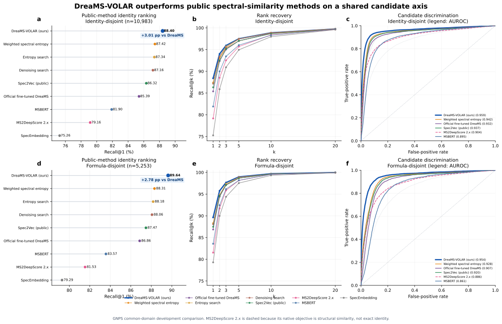
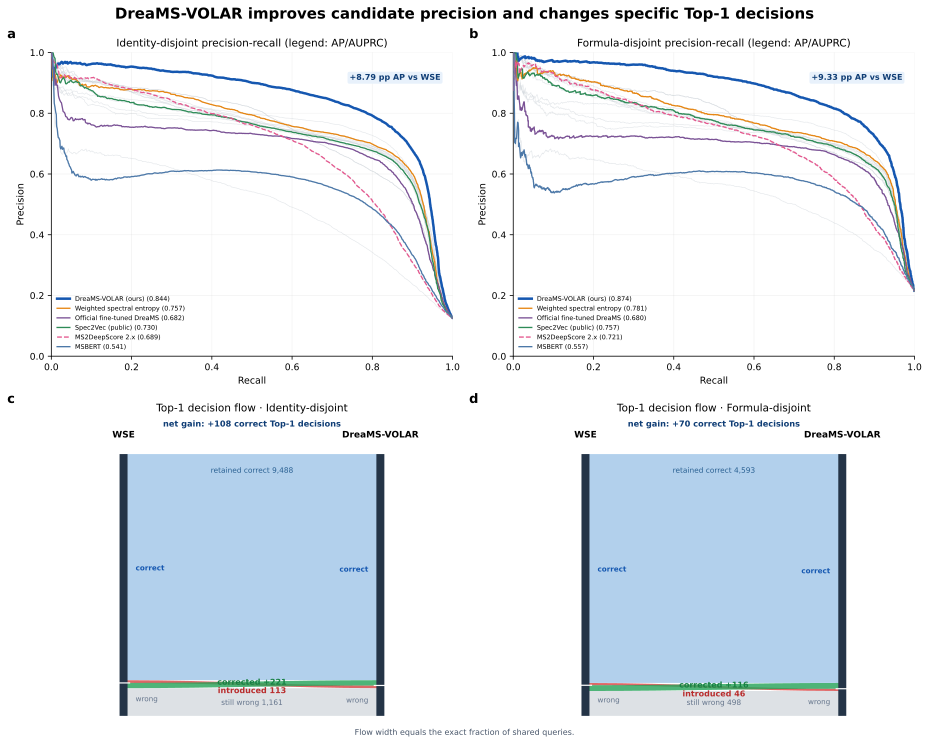
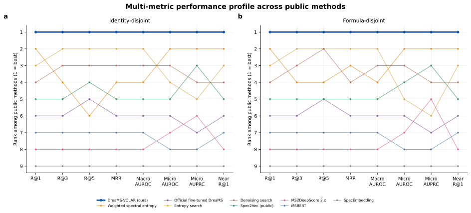

# Supporting Information

## CALMS: Context-Aware Learning for Metabolite Annotation from Mass Spectra

### S1. Task definition and panel accounting

The primary endpoint is connectivity-level molecular identification from an experimental query spectrum against precursor-compatible molecules with experimental reference spectra. A molecule is represented by the first InChIKey block. Scalar comparisons use the maximum score over measured references of that molecule. The rank of the positive candidate is one plus the number of competing candidates whose scores are greater than or equal to its score; ties therefore count against the positive. A reference spectrum and a molecular candidate are different counting units.

The two GNPS panels are not independent biological cohorts, and their query counts must not be added to obtain an independent sample count. The same applies to the two Enveda panels. The Enveda combination contains 30,343 unique queries; the original GNPS combination contains 11,019. The common 18-configuration GNPS comparison removes queries outside MSBERT's supported precursor range, [0,1000), yielding 10,983 and 5,253 queries. These filtered denominators are used throughout the main final-comparison table. Original module and scalar-ablation experiments retain their original denominators.

| Panel | Queries | Identities | Formulas | Candidate pairs |
| --- | --- | --- | --- | --- |
| Enveda identity | 25000 | 24544 | 8454 | 668458 |
| Enveda formula | 9435 | 8924 | 4426 | 58757 |
| Original GNPS identity | 10995 | 5534 | 4204 | 87518 |
| Original GNPS formula | 5261 | 2662 | 2210 | 24401 |
| Common GNPS identity | 10983 | 5528 | 4199 | 87494 |
| Common GNPS formula | 5253 | 2658 | 2207 | 24385 |

Table S1. Panel counts. Candidate pairs are query–candidate-molecule records, not unique molecules. The final two rows define the common comparison used in the main text.

### S2. Representation learning

Targeted peak views are paired with independent measured positive references and competing molecular references. The initial targeted and matched-control arms share initialization, query relationships, ordering and optimization settings. The initial native contrastive stage uses cosine triplet margin 0.1; Adam learning rate 0.000005; no weight decay; batch size four; FP32; 100 retained peaks; precursor intensity 1.1; and a trainable backbone and contrastive head.

The multi-reference stage starts from the targeted checkpoint and resumes its Adam state. For anchor a, positive reference set P and negative-molecule reference sets N_m, its hinge loss averages max(0, 0.1 + sim(a,n) − sim(a,p)) over selected positive/negative reference pairs and then over negative molecules. Its molecular loss is negative log softmax of max-reference similarity, with temperature 0.07, evaluated at the correct molecule. The total is one half of each loss. References and anchors are encoded with the same trainable encoder, and gradients propagate through both.

The training corpus contains 48,544 queries, of which 37,948 have a same-formula rival; 37,731 have a complete candidate set under the registered construction. There are 19,894 targeted views associated with 2,730 queries, 186,425 candidate-molecule records and 516,753 measured-reference rows. Per query, training selects up to four positive references, four negative molecules and three references per negative molecule, with up to two additional boundary molecules. Queries are weighted equally after internal averaging. With perturbations present, clean and collectively perturbed anchors each receive weight 0.5; otherwise the clean anchor receives weight one. Training uses one epoch, up to four queries and 64 unique spectra per step, Adam learning rate 0.000005 and seed 3407 for the principal checkpoint.

A second seed reproduced the positive direction relative to the initial adapted checkpoint but its Recall@1 interval included zero. The principal result therefore should not be described as a broad seed-robustness study. Likewise, an earlier additive continuation objective yielded only a 0.0338-point targeted-versus-random difference, with a zero lower confidence bound. That experiment is distinct from the later successful native-triplet experiment.

### S3. Chemical features and scalar scoring

Four embedding similarities and three spectral comparison scores produce seven raw channels. The embedding channels correspond to the condition-adapted encoder, chemistry-adapted native-triplet encoder, chemistry-adapted multi-reference encoder and joint condition/chemistry encoder. The spectral channels comprise weighted spectral entropy and two frozen local/composite comparison functions. Each raw score is paired with its within-query percentile. Agreement features are the fraction of Top-1 votes, mean percentile and percentile standard deviation.

The six chemical features are an availability indicator, original-minus-zero chemical utility, original-minus-worst-null utility, null spread, within-query percentile of the chemical difference and its top-gap measure. The original channel uses the unperturbed chemical assignment; it does not mean that the true candidate is supplied to the model. Controls comprise zero, reversed and candidate-rotated assignments. Unavailable chemistry has its defined zero contribution rather than being treated as chemical incompatibility. Standardization uses training-fold statistics and preserves the semantic zero of the chemical features.

The resulting 23 inputs feed a linear layer with 23 weights and one bias. This parameter count describes only the scalar layer, not CALMS as a whole. Five global formula folds are used for Enveda fitting. Repeated queries across panels have total weight one. The loss is query-balanced listwise softmax cross-entropy plus 0.01 times the query-balanced penalty for deviation from weighted spectral entropy. Optimization uses AdamW, learning rate 0.001, weight decay 0.0001, 20 epochs, batches of 256 unique queries, gradient clipping at five and seed 20261026. A final fit uses the full Enveda development set after out-of-fold evaluation.

### S4. Full-vector scoring architecture

For encoder e, let q_e and r_ej denote unit-normalized 1,024-dimensional query and reference embeddings. The reference-pair feature is the concatenation of |q_e − r_ej| and q_e ⊙ r_ej. Each encoder has a separate linear 2,048-to-64 layer, GELU and LayerNorm. A bias-free linear attention layer maps the 64-dimensional pair features to a scalar attention logit; masked normalization excludes padded references.

For each candidate and encoder, attention-weighted means and standard deviations are concatenated. Their 128-dimensional vector passes through a linear 128-to-64 layer, GELU and LayerNorm. Four encoder tokens enter four-head self-attention, a residual connection and LayerNorm, followed by a 64-to-128-to-64 feed-forward block with GELU, another residual connection and LayerNorm. The four outputs are flattened to 256 dimensions and mapped through a 128-dimensional GELU layer to a scalar raw residual. The last linear layer is initialized to zero.

The selected configuration retains up to three registered reference tokens per candidate. It excludes explicit reference count, signed embedding differences and extra scalar-score context. Query centering is applied to raw residuals before the bounded transform. The per-candidate bound is 0.6255066395, derived from Enveda scalar-model score margins. Thus, before the selected amplitude of 0.9 is applied, the largest possible change in a pairwise score difference is 1.251013279. This is a score bound, not a probability guarantee.

The architecture contains 625,345 trainable parameters and was trained for six epochs. Its ranking objective combines listwise loss and a hardest-negative softplus term, with pairwise margin 0.10 and pairwise weight 0.50 in the runtime kernel; the selected training procedure additionally regularizes the query-centered raw residual. The model's training report records the selected configuration and epoch history. The final release changes only the residual amplitude to 0.9, not the encoder or network weights. GNPS predictions informed this selection.

Missing optional full-vector inputs preserve a valid scalar score. Missing mandatory scalar inputs cause query-level abstention rather than removal of selected candidates. This operational fallback is distinct from a calibrated open-set rejection mechanism, which has not been demonstrated in the present experiments.

### S5. Complete comparison results

| Scoring configuration | R@1 | R@3 | R@5 | AUROC | AP |
| --- | --- | --- | --- | --- | --- |
| CALMS | 88.40 | 95.94 | 97.51 | 0.959 | 0.844 |
| Weighted spectral entropy | 87.42 | 95.32 | 97.00 | 0.942 | 0.757 |
| Entropy search | 87.34 | 95.72 | 97.48 | 0.942 | 0.719 |
| Local comparison + adapted encoder | 87.16 | 95.51 | 97.43 | 0.943 | 0.751 |
| Denoising Search | 87.16 | 95.52 | 97.43 | 0.942 | 0.729 |
| Local square-root cosine | 87.09 | 95.24 | 97.19 | 0.940 | 0.747 |
| Local unweighted entropy | 87.03 | 95.26 | 97.12 | 0.939 | 0.748 |
| Local comparison + DreaMS | 87.01 | 95.45 | 97.44 | 0.943 | 0.745 |
| Neutral-loss square-root cosine | 86.86 | 95.42 | 97.30 | 0.941 | 0.744 |
| Condition-adapted encoder | 86.59 | 95.13 | 97.17 | 0.944 | 0.753 |
| Spec2Vec (public) | 86.32 | 95.17 | 97.02 | 0.937 | 0.730 |
| Spec2Vec (retrained) | 86.11 | 95.20 | 97.12 | 0.938 | 0.727 |
| DreaMS | 85.39 | 95.01 | 97.01 | 0.932 | 0.682 |
| Greedy cosine | 85.08 | 94.41 | 96.70 | 0.934 | 0.740 |
| Modified cosine | 85.07 | 94.39 | 96.70 | 0.933 | 0.740 |
| MSBERT | 81.90 | 93.44 | 96.03 | 0.895 | 0.541 |
| MS2DeepScore 2.x | 79.16 | 92.52 | 95.70 | 0.904 | 0.689 |
| SpecEmbedding | 75.26 | 90.92 | 94.96 | 0.856 | 0.499 |

Table S2a. GNPS identity-disjoint comparison on 10,983 queries. Recall@1, @3 and @5 are percentages. AUROC and AP pool candidate rows. Public algorithms and internal scoring configurations are both included for completeness and are identified by name.

| Scoring configuration | R@1 | R@3 | R@5 | AUROC | AP |
| --- | --- | --- | --- | --- | --- |
| CALMS | 89.64 | 97.66 | 98.97 | 0.954 | 0.874 |
| Weighted spectral entropy | 88.31 | 97.14 | 98.69 | 0.928 | 0.781 |
| Local comparison + adapted encoder | 88.29 | 97.26 | 99.01 | 0.926 | 0.768 |
| Local square-root cosine | 88.20 | 97.09 | 98.76 | 0.924 | 0.767 |
| Local unweighted entropy | 88.20 | 97.20 | 98.80 | 0.924 | 0.770 |
| Entropy search | 88.18 | 97.39 | 98.90 | 0.920 | 0.720 |
| Condition-adapted encoder | 88.10 | 97.20 | 98.82 | 0.932 | 0.769 |
| Local comparison + DreaMS | 88.06 | 97.30 | 98.95 | 0.925 | 0.759 |
| Denoising Search | 88.06 | 97.16 | 98.90 | 0.922 | 0.731 |
| Neutral-loss square-root cosine | 87.91 | 97.26 | 98.91 | 0.924 | 0.762 |
| Spec2Vec (public) | 87.47 | 97.09 | 98.67 | 0.920 | 0.757 |
| Spec2Vec (retrained) | 87.30 | 97.01 | 98.69 | 0.921 | 0.754 |
| Greedy cosine | 87.19 | 96.97 | 98.74 | 0.923 | 0.778 |
| Modified cosine | 87.17 | 96.95 | 98.74 | 0.923 | 0.778 |
| DreaMS | 86.86 | 97.07 | 98.67 | 0.907 | 0.680 |
| MSBERT | 83.57 | 96.15 | 98.17 | 0.861 | 0.557 |
| MS2DeepScore 2.x | 81.53 | 95.85 | 98.15 | 0.886 | 0.721 |
| SpecEmbedding | 79.29 | 94.38 | 97.54 | 0.825 | 0.541 |

Table S2b. GNPS formula-disjoint comparison on 5,253 queries, using the same column definitions. Full numerical CSV files include additional ranks, mean reciprocal rank, near-subset measurements and query-level discrimination.

### S6. Scalar-model component removal

| Comparison | Enveda identity | Enveda formula | GNPS identity | GNPS formula |
| --- | --- | --- | --- | --- |
| Candidate chemistry | +0.748 | +0.435 | +0.628 | +0.912 |
| Chemistry-adapted representations | +1.300 | +0.011 | +0.045 | +0.133 |
| Local fragmentation | +0.384 | -0.095 | +0.227 | +0.361 |
| Full model vs DreaMS + WSE | +2.760 | +0.827 | +0.809 | +1.083 |

Table S3. Recall@1 difference, in percentage points, between the full scalar model and a refitted reduced model. Positive values favor the full scalar model. The last row compares the complete learned scalar model with a model based on public DreaMS and weighted spectral entropy. These experiments predate the final full-vector component and use original GNPS panels of 10,995 and 5,261 queries.

The adapted-representation group removed in this experiment consists of the chemistry-trained representations added to the condition-adapted baseline. It is not removal of all spectral encoders from the final model. Likewise, these measurements do not establish the separate contribution of reference attention, cross-encoder attention or residual bounding. The source tables preserve both positive and negative component differences.

### S7. Sample-context controls

The main sample-context analysis counts each physical query spectrum once. It contains 1,631 queries, including 753 negative-mode and 878 positive-mode queries. The 860-row historical analysis is a different counting scheme and is not used as an independent result in the manuscript. The overall 47 net corrections are the same changes responsible for the negative-mode gain; positive-mode rankings are unchanged.

Catalogue coverage and biochemical topology are distinguishable contributors. The coverage-neutral topology experiment estimates a 0.2326-point benefit, with a 95% interval of −0.3922 to 1.0181 points. The external MassBank transfer experiment has a negative overall point estimate of approximately −0.56 points. These controls limit a topology-specific or universal-transfer interpretation of the positive main sample-linked result.

### S8. Reproducibility and source map

All project sources in this package correspond to repository revision eacdaebb9044e5899b3c7de49e6c9ebf7f2573fa on branch codex/contrast-atlas-panredu-20261016, inspected on 3 November 2026. CALMS is the manuscript name. The final implementation is identified in the source tree as Full23 v1.3.2, and the existing artwork release uses DreaMS-VOLAR. These identifiers refer to the model described in the manuscript and do not denote additional competing methods. The supplied source files preserve their original names for reproducibility; the manuscript and redrawn figures use CALMS.

Primary result files: deliverables/mega_sota_ladder/gnps_run18_msbert_common_20261102/{identity,formula}/summary_metrics.csv and paired_comparisons.json. Model architecture and selection: deploy/unified_additive_full23_v132/manifest.json; evidence/training_report.json; evidence/training_contract.json; runtime/full23_tensor_set_readout_core.py. Public implementation and checkpoint registry: tasks/mega_sota_methods_v1.json. Scalar component removal: deliverables/dreams_volar_publication_figures_20261102/strict_refit_evidence_contribution.csv.

Condition-learning results are recorded in docs/NOISE_ENCODER_P2B_AND_RERANKER_POSITIVE_RESULTS_20260930.md. Chemistry experiments are recorded in docs/GLM_CHEMAWARE_ALGORITHM_POSITIVE_RESULTS_LEDGER_20260930.md. Sample-context analyses are recorded in docs/BIOAWARE_B35_REAL_LIBRARY_RETRIEVAL_BENCHMARK_20260912.md, BIOAWARE_B44_MASSBANK_EXTERNAL_RESULT_20260913.md and BIOAWARE_B45_COVERAGE_NEUTRAL_TOPOLOGY_RESULT_20260913.md. The accompanying source package contains these records and the exact numerical tables used for plotting.

The main figures are reproducible from make_figures.py, which uses recorded aggregate results rather than simulated observations. Figures 1–6 are newly arranged for the manuscript. The supplementary benchmark artwork reuses the pushed vector figures, changing the display name to CALMS. These supplementary curves were not reconstructed from AUROC values. The original vector sources are retained alongside the manuscript artwork.

### S9. Supplementary benchmark artwork

Figure S1. Full comparison artwork from the released result package: Top-1 ladders, Top-k recovery and candidate-level ROC curves for both common GNPS panels. Thin grey ROC curves include additional scoring configurations. The source plot's comparison refers to the registered public checkpoint configurations, not to every published implementation or task setting.

Figure S2. Candidate-level precision–recall curves and paired decision flows relative to weighted spectral entropy. Flow widths represent query fractions. Green and red paths correspond to errors corrected and introduced, respectively. Candidate-level average precision is distinct from per-query annotation accuracy.

Figure S3. Multi-metric rank profiles among the nine principal displayed methods. Rank one is best within a panel and metric. These relative ranks do not measure the size of a performance difference.
